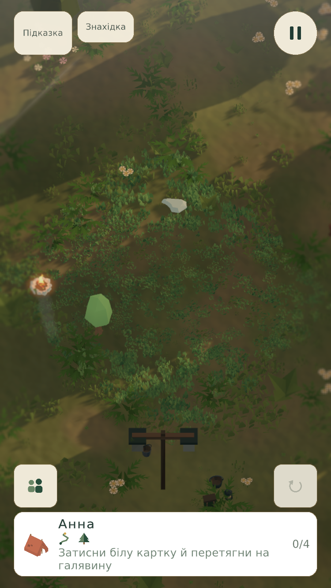
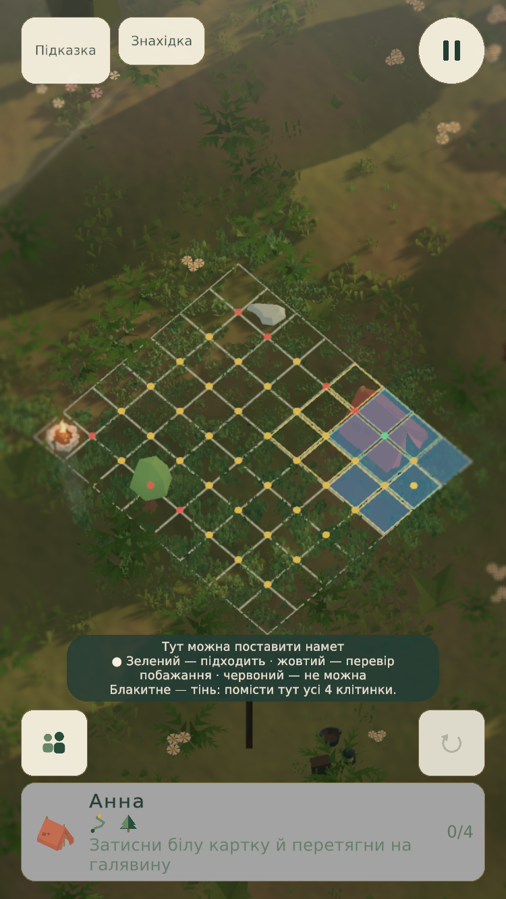
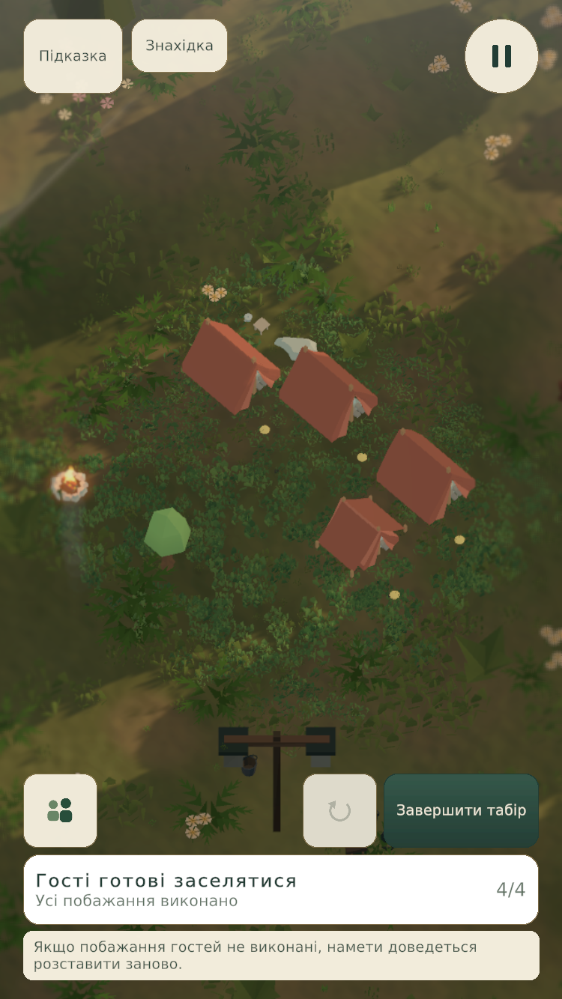

# Зрозуміле розміщення та навчання табору

## План і межі змін

1. Зберегти `CampSession` і `RuleEvaluator` єдиними джерелами стану й правил.
2. Приховати сітку до початку встановлення/переміщення намету. Після відпускання, скасування й переходу повернути чисту сцену.
3. Показувати можливі центри намету для поточного повороту: зелений — усі чинні правила виконано; жовтий — розміщення допустиме, але є порушене побажання або прохід; червоний — зайняті чи заборонені клітини. Поворот перераховує підказки.
4. Блакитне покриття пояснює тінь, тишу або їх перетин для вибраного гостя. Друзі потребують реального шляху довжиною до трьох кроків між дверима, а не лише близьких центрів наметів.
5. Біла картка гостя містить дію «затисни й перетягни», під час утримання стає сірою.
6. Ввести 20 навчальних рівнів для нових гравців. Незавершений старий гід мігрує зі збереженням уже вивчених дій; завершений або пропущений не запускається повторно. Пропуск залишається доступним.
7. Перевіряти табір одразу. Після успішного збереження — закривання наметів і автоматичний перехід через 1,6 с. Невдала перевірка очищає спробу; кожна третя послідовна невдача дає конкретну безкоштовну підказку без витрачання запасу. Навчальні перевірки не витрачають життя. Помилка запису не дозволяє перейти або зарахувати невдачу.

## Послідовність

Порядок локацій, стабільні ID, геометрія, сюжет і еталонні розміщення зберігаються. Передчасні обмеження прибираються; нових умов, яких немає у вихідному пазлі, автоматично не додаємо.

| Рівень | Коротка тема гіда / практика |
|---|---|
| 1 | Картка, перетягування, двері, поворот, завершення |
| 2 | Переміщення та скасування дії |
| 3 | Нове: увесь намет у тіні |
| 4–8 | Самостійне розміщення, проходи; повторення тіні там, де вона потрібна |
| 9 | Нове: тиша подалі від вогнища |
| 10 | Практика тиші разом із тінню |
| 11 | Нове: друзі, до трьох кроків між дверима |
| 12–13 | Практика вже відомих побажань |
| 14 | Нове: додаткові входи й виходи |
| 15–18 | Поєднання вимог і відкритих проходів |
| 19–20 | Самостійне облаштування й закріплення |

Текст кожного рівня задається у `learning_curriculum.json`; переклади — у чинних каталогах локалізації. Гід має одну коротку репліку на тему, а результат пояснюють підсвічування та стан намету.

## Спільні системи

- `PlacementGuidance` оцінює можливі позиції через `CampSession.Preview`. Немає другої реалізації правил.
- `BoardRenderer` повторно використовує невеликий пул маркерів; переміщення курсора не перебудовує рослинність або оточення.
- `CampAttemptService` керує перевіркою, записом і очищенням невдалої спроби. `CampEconomy` зберігає лічильник невдач і право на підказку транзакційно.
- `TentStoryVisual.Close` фіксує закритий стан: подальше `ShowCare` не відкриває вхід.
- `LearningCurriculumAuthoring` змінює лише правила через `LevelAuthoringCampaign.PrepareApply(includeArt:false)` та спільну захищену транзакцію двох проєктів. Геометрію й оформлення змінюють через WorldOps. Старі ревізії та ручні чернетки захищені.
- Контрольований захват WorldOps зберігає власний розклад симуляції; звичайна гра переходить автоматично.

## Приймання

Перевірити відсутність сітки до перетягування та після скасування; колір картки при утриманні; поворот і зайняту клітину; тінь, тиху тінь, друзів і заблоковані двері; усі 20 навчальних кроків і відновлення прогресу; третю невдачу, витрати життя та помилку збереження; закриті намети після ефекту турботи; автоматичний перехід у звичайній грі. Чинні 100 еталонних рішень мають залишатися правильними.

Результати нативних перевірок і скриншоти зберігаються окремо від цієї інструкції. План не є підтвердженням проходження перевірок.

## Ігрові кадри перевірки

Кадри QC010, 750×1334, активний інтерфейс, нативний Game View. Прогрес тестового запуску — лише в пам’яті.

| До розміщення | Під час перетягування | Усі намети встановлено |
|---|---|---|
|  |  |  |

## Результати перевірки

269 EditMode-тестів пройшли без помилок: навчальні кроки й міграція, правила всіх 100 пазлів та їхні рішення, старі збереження, камера, розміщення, майстерня й WorldOps. Сім перевірок Python-транспорту та перевірка похідних стилів також пройшли.

У нативному запуску з прогресом лише в пам’яті перевірено приховування сітки, утримання та скасування, читабельність підказок поверх трави, третю невдачу з безкоштовним зразком без витрат запасу підказок і автоматичний перехід QC010 → наступний рівень. Завершене старе навчання можна явно перезапустити: тоді відкривається новий курс із 20 рівнів.
