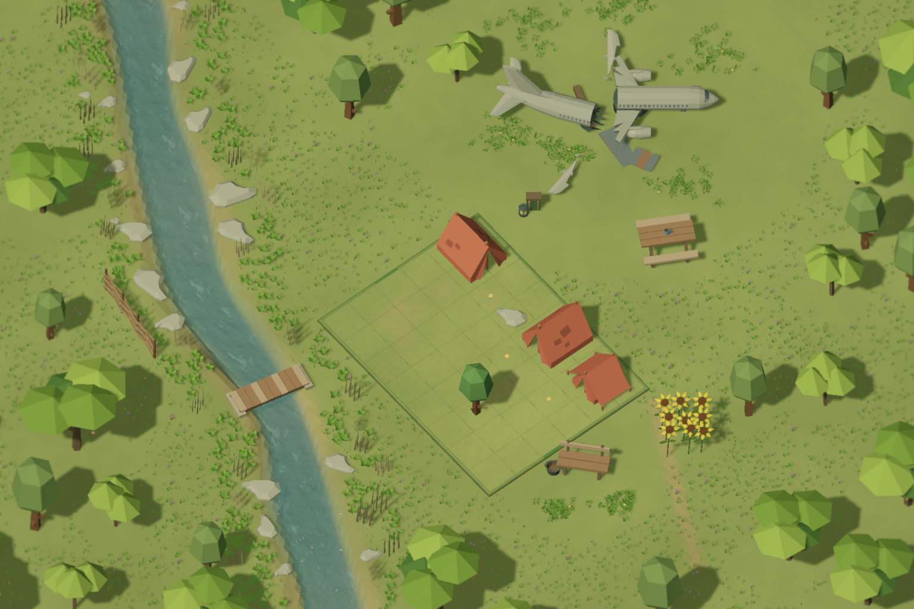
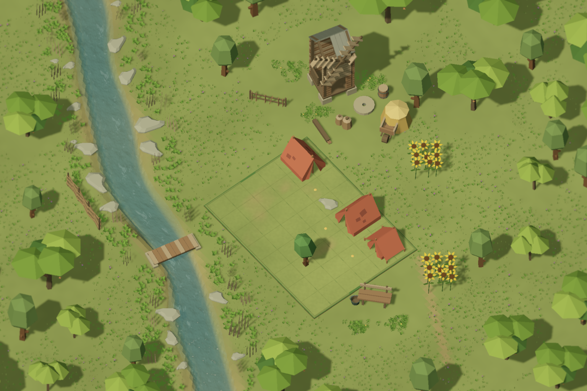
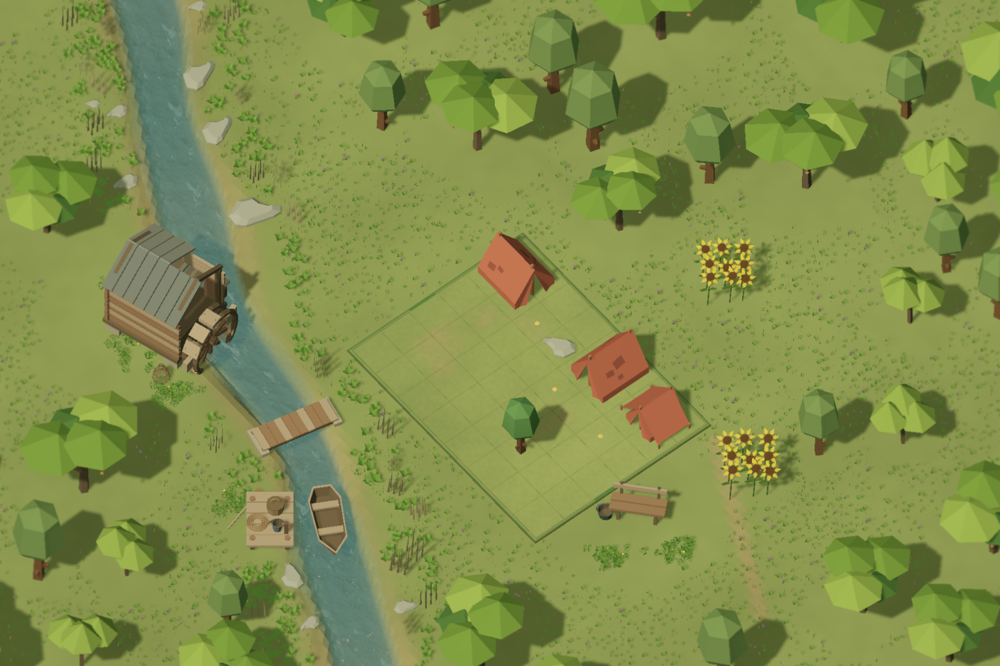

# Пропси та великі об’єкти

У майстерні відкрийте **Об’єкти → Пропси** або **Великі об’єкти**.
Доступні 24 пропси, три зібрані орієнтири й п’ять окремих частин.
Усі вони — декор: правила тіні, шуму та зайнятості клітин залишаються в інструменті **Поле**.

Готові композиції: **Новий → Приклади → Літак на узліссі / Вітряк біля поля / Водяний млин на березі**.
Відкриваються як нові редаговані чернетки. Або відкрийте збережені JSON:
[літак](aircraft.draft.json), [вітряк](windmill.draft.json), [водяний млин](watermill.draft.json).

## Розміщення

1. У **Пропси** оберіть набір: табір, сільський двір, берег або старі споруди.
2. Оберіть картку, поворот і масштаб; натисніть **Поставити об’єкт у Scene View**.
3. Клацніть поверхню. `Esc` завершує розміщення; далі використовуйте звичайні інструменти Unity.
4. Червоний контур великого об’єкта означає перетин поля: розміщення й експорт блокуються.
   Помаранчевий означає можливе перекриття клітин з ігрової камери; перевірте композицію.
5. Для човна, причалу й водяного колеса доступні висота від води та її зміщення.
   Вручну задана висота зберігається без повторної прив’язки до землі.
6. **Показати окремі частини** відкриває передню та хвостову частини літака,
   відокремлене крило, лопаті вітряка й водяне колесо.

## Джерела

Метадані, українські назви та геометрія: `Assets/QuietCamp/Authoring/LevelProps`.
Відтворення: `python tools/build_authoring_props.py`; перевірка без запису: додайте `--check`.
Розмір моделей задано в метрах; масштаб картки за замовчуванням — 1.
Матеріал використовує чинний CampArtLit і спільну приглушену палітру.
Текстури й рослини в моделі не запікаються.

Передню та хвостову геометрію літака адаптовано з Poly by Google, CC BY 3.0.
Атрибуція зберігається в `LevelProps/ATTRIBUTION.md` і має супроводжувати поширення.
Повторне використання геометрії не активує roadmap.

## Перевірка

Фінальний прохід Unity 6000.6.2f1: **66 EditMode tests, 0 failures**,
зокрема перевірки експорту, збереження, Undo/Redo, висоти човна, повного контуру
та незалежності збереженої геометрії від оновлень палітри.
Усі три приклади відтворено в Gameplay з ідентичною композицією та прогресом у пам’яті.
[Вісім циклів візуальних правок і перевірки](REVIEW-UA.md).
