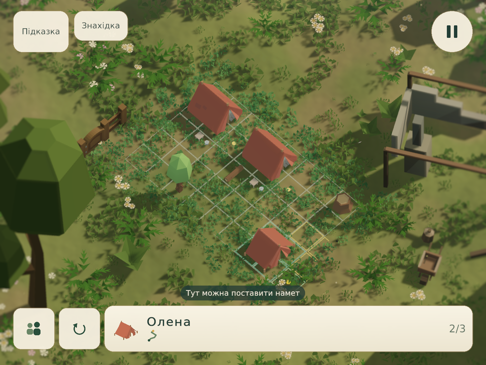
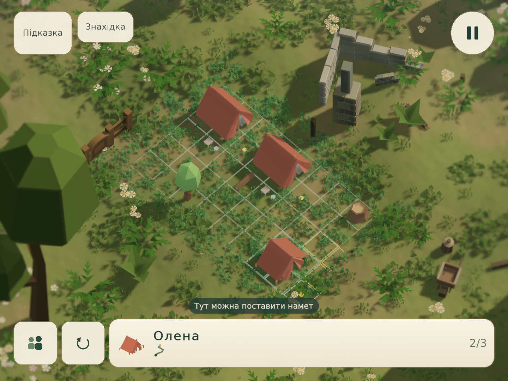

# Природніша конструкція головних об’єктів

16 жовтня 2026. До спільного покращення матеріалів додано опрацювання головної руїни на рівні №17, `gen:qc_camp:7`. Це перевірений приклад застосування нової геометрії, а не твердження про завершене переоформлення всіх 100 головних об’єктів.

Руїна отримала окремі перев’язані кам’яні ряди, сколи з реальною товщиною, нерівну висоту залишків стін і локальне старіння. Прибрано цілу верхню раму, яка робила місце схожим на новобудову. Додано окремі редаговані уламок кладки й пошкоджену балку. Вони розміщені через Prefab World Builder і прив’язані до рельєфу наявною геометричною перевіркою контакту.

Споруду пересунуто в межі видимої композиції. Ігрова камера й центр поля збережені. Важкий фундамент частково заглиблено в нерівну землю: нижні точки вже не висять над нею. Старіння тепер розраховується узгоджено на спільних вершинах поверхні; сусідні трикутники не утворюють випадкових темних діагоналей. Нормалі граней зберігають low-poly стиль.

## Ігрові кадри

До:

Після дев’яти циклів:

Обидва кадри — незмінені PNG з Game View 1440×1080, з тим самим пазлом, інтерфейсом і відтворенням розміщення наметів. Промені, частинки й вітер можуть відрізнятися між запусками.

## Перегляди й виправлення

| Цикл | Недолік попереднього кадру → виправлення | Висновок перегляду |
|---|---|---|
| C01 | Суцільна коробка стіни → окремі перев’язані ряди кладки. | Шви читаються; краї залишаються надто гострими. |
| C02 | Ідеальні ребра → замкнені камені зі скошеними, неоднаково сколотими кутами. | Край отримав товщину; дерев’яна рама ще виглядає новою. |
| C03 | Ідеально прямі довгі балки → малий прогин зі збереженими опорними кінцями. | Самої деформації недостатньо: ціла рама суперечить історії руїни. |
| C04 | Незруйнований каркас над руїною → прибрано верхню раму, залишено різновисокі стіни й короткі опори. | Силует переконливіший; правий край споруди ще обрізаний кадром. |
| C05 | Обрізаний головний об’єкт → перенесено руїну без зміни камери чи масштабу. | Споруду видно повністю; бракує наслідків руйнування біля основи. |
| C06 | Руйнування без уламків → додано окремі балку й фрагмент кладки, перевірено їхній контакт із рельєфом. | Історія читається краще; матеріал каменів ще занадто рівномірний. |
| C07 | Однакова кладка → стримана варіація каменів і патьоки через чинну систему старіння. | **Відхилено:** виявлено темні трикутні артефакти. |
| C08 | Різне старіння сусідніх трикутників → виправлено спільну `SurfaceWeathering`. | Діагоналі усунено; окремі нижні точки ще зависають над нерівною землею. |
| C09 | Зазори до 26 см під основою → часткове заглиблення важкого фундаменту за реальними нижніми вершинами. | Прийнято для цього рівня після огляду ігрового кадру. |

На початку перевірки виправлено дві технічні помилки запису: редакторський ID чернетки не підходив для відтворення опублікованого рівня; стара перевірка кадру використовувала застарілу рамку камери. Помилкові спроби не зараховані як додаткові художні цикли. Квитанції, хеші та результати перевірок — [Verification/landmark-polish-20261016.json](Verification/landmark-polish-20261016.json).

## Повторне використання

`tools/landmark_craft.py` розширює чинний генератор конструкцій: кладка, замкнені сколи та прогин дерева запікаються в геометрію. Нових компонентів або обчислення цих змін щокадру немає. Меблі, метал і важкі споруди не отримують випадкового загального нахилу.

`Assets/QuietCamp/Authoring/CampaignLandmarks/craft.json` містить перелік опрацьованих конструкцій. Зараз у ньому рівень 17. Інші головні об’єкти додаються після окремого перегляду; перелік не слід автоматично розширювати на всі рівні. Резервації 100 унікальних головних моделей і стабільні ID збережені.

Відтворення геометрії: `python tools/build_campaign_landmarks.py`, перевірка — та сама команда з `--check`. Підготовка редагованої композиції виконується через `tools/stage_landmark_craft.py`; для прийнятого варіанта використані `--position -6.05 1 --ruin-traces --stone-wear --buried-foundation`. Застосування до кампанії проходить через чинну `LevelAuthoringCampaign.Apply`, з перевіркою пазла, конфліктів джерела й збереженням історії.

Повністю деталізована руїна містить 2104 трикутники замість 144. Це вкладається в авторський ліміт 4500, але не є вимірюванням продуктивності телефону. Загальна густота лісу й поодинокі великі силуети підліску залишаються окремим напрямом подальшого опрацювання.

Перевірено 197 EditMode-тестів Unity та 7 Python-тестів конструкцій; помилок немає. Опублікований рівень проходиться звичайним перетягуванням наметів і перевіркою рішення. Окремо пройдений запуск із меню в Game View 750×1334: поле відцентроване й доступне для гри. У цьому вузькому форматі праве закінчення руїни ще частково виходить за кадр; художнє приймання вище стосується показаного кадру 1440×1080. Це залишене обмеження композиції, а не підтвердження ідеального кадру в усіх форматах.

Усі 100 опублікованих головних моделей зберігають унікальну геометрію та відповідність своїм резерваціям. Зміна рівня №17 не змінила пазли, сюжет, попередню історію контенту або дані інших 99 рівнів. Джерела захоплення, прогрес гравця й робоча чернетка під час тестових запусків збережені без змін.
