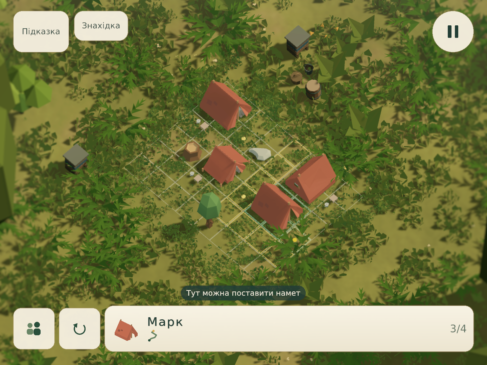
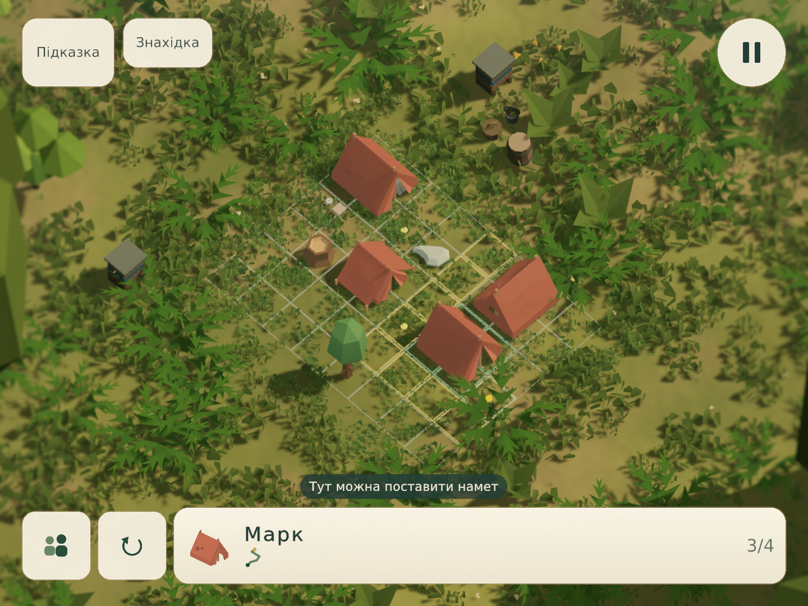

# Матеріали землі й рослинності — 16 жовтня 2026

Оновлено спільні `CampArtLit` і `PlacementGrid` у репозиторії та відкритій QA-копії. Рівні, які використовують ці матеріали, отримують зміни автоматично. Композиції, пазли, камера й сезонні пресети не перезаписуються.

Трава отримує освітлення від поточної погоди замість постійного зеленого підсвічування. М’яке двобічне освітлення зберігає читабельність листя в тіні. Темніші основи й більші групи відтінків пов’язують рослини із землею; кольори квітів залишаються авторськими. Земля має виразніші переходи моху й ґрунту, які не утворюють окремого прямокутника поля. Тонкий темний край сітки допомагає їй читатися на світлій поверхні.

Прибрано додаткове зміщення трави лише у видимому проході шейдера. Тепер видима геометрія, глибина та тінь використовують ту саму `WeatherPosition`, включно з реакцією на вітер і приминання.

## Порівняння

Справжній Game View рівня №21 (`gen:qc_camp:12`), 1440×1080, з активним інтерфейсом і розміщенням четвертого намету. Початковий кадр — з попередньої перевірки цього самого опублікованого рівня; фінальний — після семи циклів нижче. Збережено ту саму роздільність, ракурс, пазл і послідовність введення. Рух частинок та вітру між сеансами може відрізнятися.

До:

Після:

## Сім послідовних циклів

Кожен наступний цикл починався після відкриття й перегляду попереднього PNG. Джерела залишалися незмінними протягом кожного запису; інструмент реально перетягував картки наметів і завершував пазл штатною перевіркою.

| Цикл | Знайдений недолік і зміна | Результат перегляду / що залишилося |
|---|---|---|
| C01 | Постійне зелене підсвічування стирало тіні трави; прибрано фіксований мінімум світла. | Самостійно цей варіант відхилено: грані стали надто темними й строкатими. |
| C02 | Чорні ділянки після C01; додано м’яке двобічне розсіювання зі світлом пресету. | Тіні спокійніші; рослинність ще мало пов’язана з основою. |
| C03 | Однаковий тон уздовж рослин; додано затемнення основи за наявними вагами й широку просторову варіацію зелені. | З’явився перехід від основи до верхівок; відкритий ґрунт ще однорідний. |
| C04 | Мох і земля майже губилися між травою; розширено їхні нерівномірні ділянки. | Ґрунт різноманітніший, без очищених майданчиків; залишалася розбіжність колихання й тіні. |
| C05 | Видимий прохід додавав зсув, якого не було у глибині й тіні; залишено спільну деформацію. | Контури збережені; сітка ще слабко читається на світлій землі. |
| C06 | Світла сітка губилася; додано вузьку темну облямівку без заливання клітин. | Межі спокійніше відокремлюються від ґрунту; дрібна варіація землі ще переважала над великою. |
| C07 | Надто дрібний масштаб переходів ґрунту; посилено великі плями й зменшено частку дрібного шуму. | Прийнято як обмежене покращення матеріалів цієї композиції. Це не приймання всіх декорацій кампанії. |

Квитанції та SHA-256 кадрів: [Verification/visual-polish-20261016.json](Verification/visual-polish-20261016.json). Приватні PNG кожного циклу лежать у QA `UserSettings/QuietCampVisualReview20261016/C01…C07/L021`.

## Межі перевірки

Дощовий QC009 і зимовий №75 додатково перевірені як регресійні сцени: розміщення, сітка, завершення пазла, контакт опадів, активна атмосфера й збереження стану. Це технічні перевірки, а не нові прийняті художні кадри цих локацій. Окремо перевірено звичайний вхід через головне меню в портретному Game View.

Ця робота не є повним художнім переглядом 100 рівнів або вимірюванням продуктивності на телефоні. На літньому прикладі залишаються великі повторювані силуети підліску; для зимових наметів ще потрібне окреме опрацювання повторюваного рисунка снігу. Річка не потрапляє в обраний кадр; її матеріали й попереднє приймання не змінювалися.
