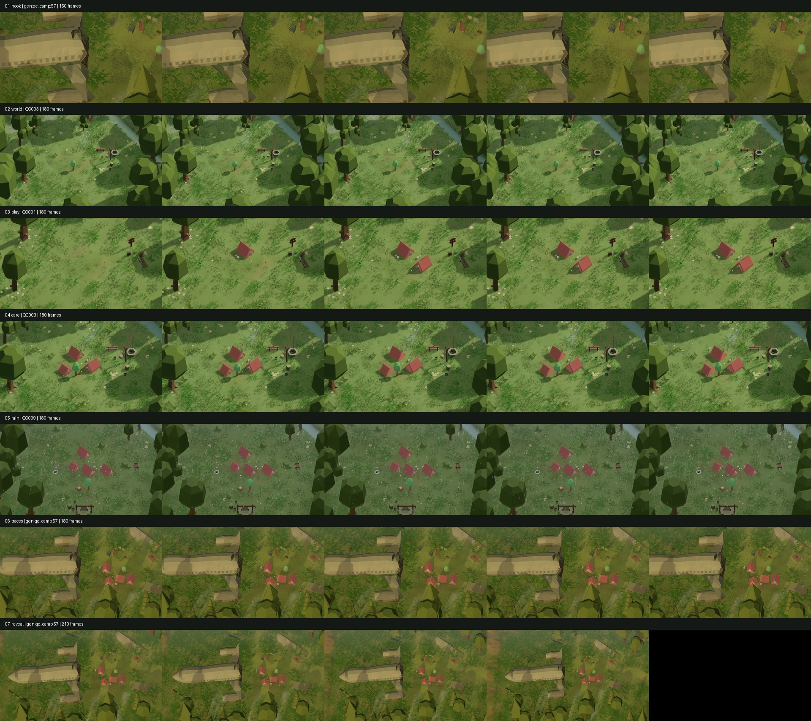
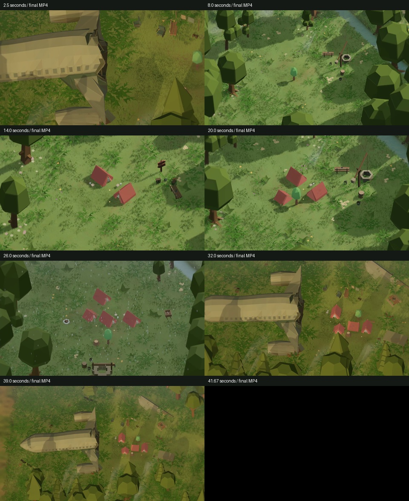

# Ігровий тизер QuietCamp — 42 секунди

Реальні QC001, QC003, QC009 та Sunfield (`gen:qc_camp:57`) з чинної кампанії.
Розміщення й завершення виконуються через CampSession; погода, вітер, вода,
рослинність, музика й звуки походять із гри. UI приховано лише під час зйомки.
Немає AI-відео, титрів, логотипу, голосу або вигаданих вибухів чи механік.

Редагована постановка: `QuietCamp/Assets/Marketing/Teaser/`.
Доставлений файл у локальному Unity-проєкті:
`QuietCamp/Marketing/Exports/Teaser_v01_1920x1080_30fps.mp4`.
Великі MP4/PNG не зберігаються в Git; їх повторює документований workflow.
Фінальний файл: 42.000 s, 1260 frames, H.264 Full HD 30 FPS, stereo 48 kHz,
41.12 MB. Повне декодування й контрольні кадри пройшли перевірку.

- [Як повторити](../../../QuietCamp/Assets/Marketing/Teaser/Documentation/HOW_TO_REGENERATE.md).
- [Аудит сюжету, ресурсів і ліцензій](../../../QuietCamp/Assets/Marketing/Teaser/Documentation/PROJECT_AUDIT.md).
- [Сім кадрів і таймінг](../../../QuietCamp/Assets/Marketing/Teaser/Documentation/TEASER_STORYBOARD.md).
- [Технічний процес](../../../QuietCamp/Assets/Marketing/Teaser/Documentation/TEASER_TECHNICAL.md).
- [Результати перевірок](../../../QuietCamp/Assets/Marketing/Teaser/Documentation/QA_REPORT.md).

Контрольні кадри декодовано з реальних Recorder MP4; написи тут — підписи звіту,
у самому відео їх немає. Вибірка включає перший і останній кадри кожного фрагмента,
тобто обидва боки всіх монтажних стиків. Це приймання тизера, не всієї кампанії.

