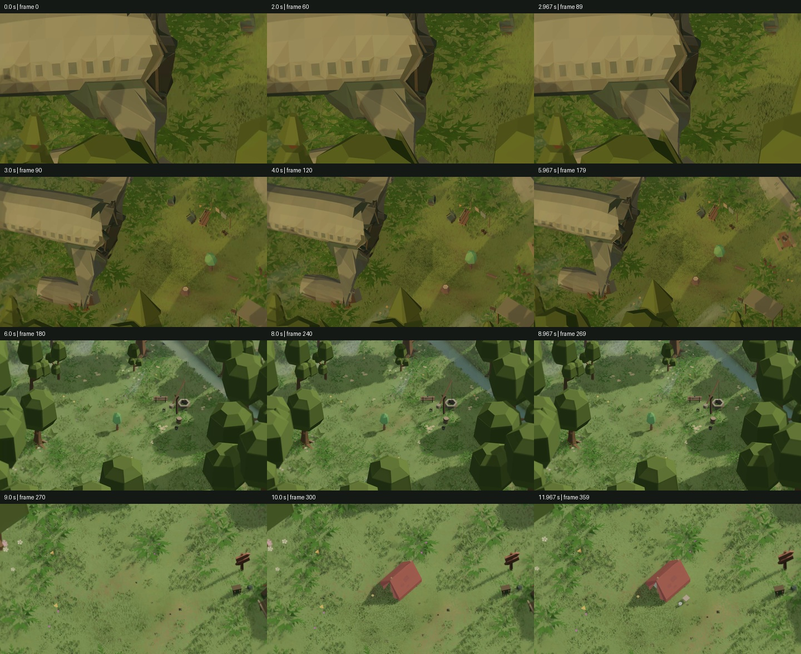
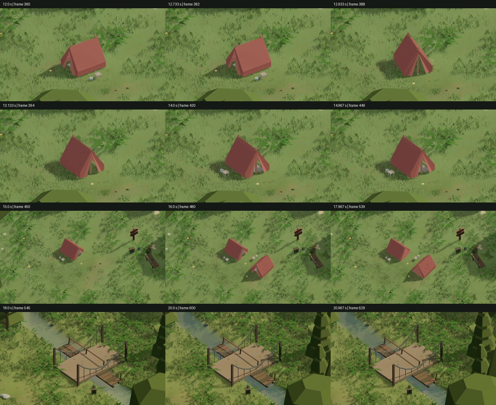
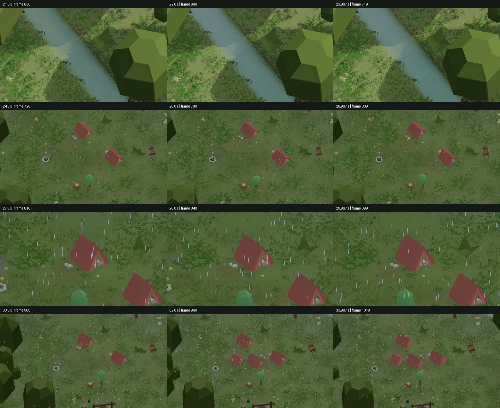
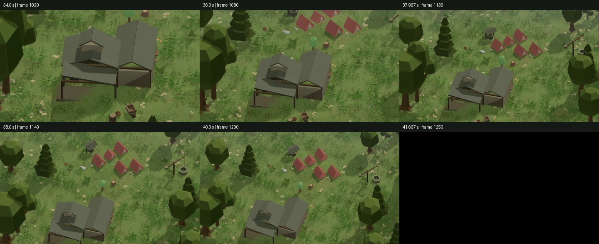

# V02 — фактичний запис і перегляд, 19.10.2026

**Фінальний файл створено:**
`QuietCamp/Marketing/Exports/v02/Teaser_v02_1920x1080_30fps.mp4`.
Копія є також у відкритому QA-проєкті. MP4, вихідні takes та повні PNG —
локальні файли поза Git; код, авторські Unity assets, звіти й прев’ю — у Git.

| Перевірка | Фактичний результат |
|---|---|
| Тривалість | 42.000 секунди |
| Відео | 1260 кадрів, H.264, 1920×1080, 30 FPS, 16:9 |
| Звук | AAC, stereo, 48000 Hz, ігровий звук та власна музика записані Unity |
| Рівень звуку | Peak −5.58 dBFS, RMS −26.28 dBFS; без clipping і нечислових samples |
| Розмір | 37 281 824 bytes, 37.28 MB |
| Повне декодування | Усі 13 native MP4 і фінальний MP4 пройшли перевірку |
| Джерела | 13 квитанцій мають однаковий sourceHash, memoryOnly=true, recorded=true |
| Render count | 1260 нативно записаних кадрів, без пропусків за квитанціями |
| Монтаж | 24 перевірки: кадр перед і після кожного з 12 cuts збігається з native take в межах похибки повторного H.264-кодування |
| Темрява | Тільки кадри 1245–1259 повністю чорні: 41.5–42.0 с |
| Згасання | Із 40.8 с знижується експозиція й гучність; чорний cut завершує монтаж без титрів |
| Прогрес | SHA-256 усіх чотирьох постійних файлів до/після збігаються |
| V01 | 33 контрольні хеші: MP4 та авторські assets залишилися незмінними |
| Середовище | Уже відкритий Editor 6000.6.2f1; жодного player build |

Хеш джерел запису:
`91108331a8eb9fe345b078a868b369fcdc5f20845f703266613b0f34b7e3c3ef`.

SHA-256 MP4:
`e7617b7ac95120978359eb38010775ccdad90ba134fe111b77823c1bb529117b`.

## Реальні дії й локації

QC001: спочатку законний TryCommit із альтернативним поворотом; потім
TryCommit тієї самої палатки з іншою орієнтацією. TentPresenter виконує
наявну анімацію повороту. Другий намет і справжній Check завершують табір.
Це не рекламна анімація будівництва і не DebugApplyWitness.

QC009: попередньо встановлено два намети; ще два ставляться сигналами Timeline,
після чого Check.IsSolved=true. Дощ, круги й бризки на землі, тканина й вітер —
наявні системи гри, записані в рушії.

Інші плани: Sunfield `gen:qc_camp:57` (кампанія №42), вода й галявина QC003,
дерев’яна переправа `gen:qc_camp:29` (№36), Гавань `gen:qc_camp:122` (№100).
У Гавані п’ять наметів і справжнє завершення табору. Не імітуються падіння
літака, ремонт споруд, ходіння персонажів або окрема механіка дослідження.

## Критичний перегляд та повторний запис

1. Пробні native записи перевірили літак, близький дощовий намет і Гавань.
   Для фіналу розширено кадр, щоб дах не витісняв намети.
2. Перший повний 42-секундний кандидат відхилено. Станційна вставка показувала
   переважно порожній знак, а крони закривали воду. Для неї збережено окремий
   негативний verdict; це не прийнятий результат.
3. Станційний план замінено чинною дерев’яною переправою. Річку перекадровано
   на відкритий коридор русла. Обидва плани перевірено окремими native записами.
4. Повторно записано **всі 13 планів** з однієї актуальної версії джерел.
   Старі кадри й квитанції до фінального набору не домішувалися.
5. Переглянуто **42 зображення фінального MP4**: кожні дві секунди, обидва боки
   усіх стиків та додаткові фази повороту намету. Вибірка не містить HUD,
   меню, курсора, титрів, логотипів чи завантажувальних екранів. Річка відкрита,
   переправа впізнавана, поворот видно, фінал показує нову локацію.

`Review/packet.json` містить також 65 native контрольних PNG. Окремий
`verdict.json` прив’язує художній висновок саме до переглянутих 42 фінальних
зображень, packet і MP4 через SHA-256. Згенеровані докази вручну не виправлялися.

## Залишені обмеження

- Під час boot одного з native прогонів було **попередження**
  `Menu scenery unavailable; navigation remains usable. InvalidOperationException: witness:unsolved`
  з MenuSceneHost.TryBuildWorld. Це fallback фонового меню, не збій Recorder;
  записані Camp views і показані перевірки завершення успішні. Попередження
  не виправлене цією маркетинговою ревізією й не оголошене відсутнім.
- RecorderRenderBridge залежить від внутрішнього API Recorder 5.1.7; сумісність
  з іншою версією не доведена. Повторний scrub через ігрові дії потребує restart shot.
- Seed, команди й камери повторювані; DSP, shader time та частинки не bit-exact.
- Близькі кадри зберігають грановану low-poly геометрію. Мікродеталізація моделей
  чи фотореалістична вода не створювалися як частина тизера.
- Тональність музики збережена, гучність і паузи уваги перебудовані під кадри;
  окремого нового музичного твору або зовнішньої звукової підкладки немає.
- Оцінка приймає цей монтаж V02. Вона не доводить реакцію нових глядачів,
  продуктивність мобільної збірки чи якість усіх 100 рівнів.

[Порівняння всіх фрагментів V01/V02](../V01_V02_COMPARISON.md).

