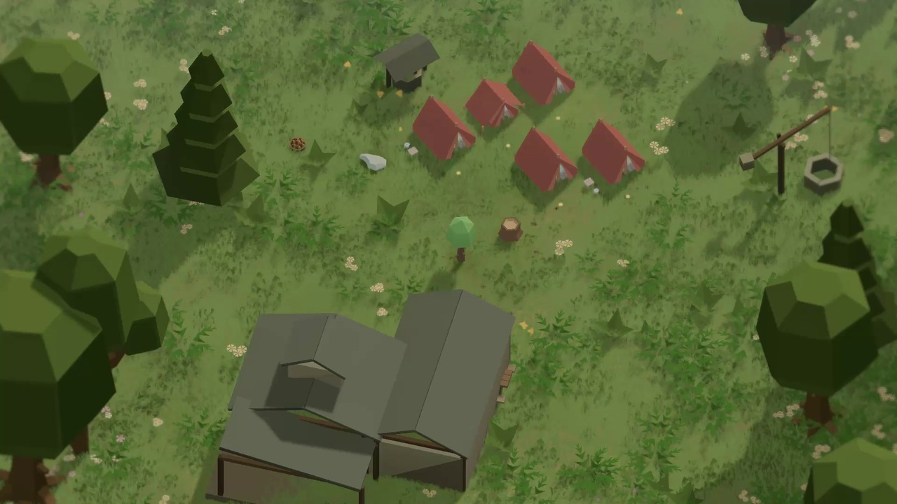

# QuietCamp Teaser V02

Готовий локальний MP4: **42 секунди, 1920×1080, 30 FPS, stereo 48 kHz,
37.28 MB**. [Фактичне QA](QA_REPORT.md),
[порівняння V01/V02](../V01_V02_COMPARISON.md).



Редагована версія: `QuietCamp/Assets/Marketing/Teaser/V02/`.
Окремі Teaser_v02.asset, Master42_v02.playable, 13 камер, сплайни, криві,
профілі та сцена не замінюють авторські assets і MP4 версії V01.

## Повторний запис

Потрібна вже відкрита QA Unity 6000.6.2f1 з наявними Cinemachine 3.1.7,
Timeline 6.6.0, Splines 2.8.4 та Recorder 5.1.7. Новий Editor чи player build
ці команди не запускають.

```powershell
python tools/install_teaser.py --project C:/Users/Public/qcui-20261006/QuietCamp
python tools/refresh_existing_editor.py --pid 7632
python tools/qc_world.py --project C:/Users/Public/qcui-20261006/QuietCamp teaser create --version v02
python tools/qc_world.py --project C:/Users/Public/qcui-20261006/QuietCamp teaser validate --version v02
python tools/qc_world.py --project C:/Users/Public/qcui-20261006/QuietCamp teaser record --version v02
```

Команда record лише ставить native роботу в чергу. Дочекатися `captured` і
13 квитанцій через `teaser status --version v02`, потім:

```powershell
python tools/package_teaser.py --project C:/Users/Public/qcui-20261006/QuietCamp --version v02
python tools/review_teaser.py --project C:/Users/Public/qcui-20261006/QuietCamp --version v02 --final
```

Файл: `Marketing/Exports/v02/Teaser_v02_1920x1080_30fps.mp4`.
У тій самій папці — атрибуція, native takes, технічна квитанція та Review.
Усі звуки походять із запису Unity; пакування тільки об'єднує takes і
застосовує master gain. `--gain-db 0` зберігає початковий рівень міксу.
Власний синтезований score відтворюється у рушії з глобальної позиції монтажу.

## Редагування

Меню **Tools → Marketing → Teaser → V02**: відкрити, переглянути, записати.
У Teaser_v02.asset редагуються кадри, тривалість, ціль камери, рух, кінцевий
масштаб/кут, кількість попередньо встановлених наметів, освітлення й звук.
Готові дії — сигнали Timeline; звичайні `place-N`, `place-alternate-N`,
`complete-camp` проходять через CampSession. `look:shot-id` позначає застосування
редагованого профілю й світла кадру. Довільний C# із конфігурації не виконується.

Після зміни порядку/тривалостей: **Apply Configuration** або `teaser bake --version v02`.
Після редагування control points сплайнів у prefab TeaserRig_v02: зберегти prefab
й **V02 → Bake Edited Splines**. Ця дія запікає шлях у Timeline animation curves.
Apply Configuration натомість відбудовує шляхи з параметрів shot — це різні дії.
Усі плани мають окремий preview: `teaser preview --version v02 --shot 0` (індекси 0–12).
Повторний початок shot потрібний після scrub назад через ігрову команду.

Приклад керованого перекадрування:

```powershell
python tools/qc_world.py --project C:/Users/Public/qcui-20261006/QuietCamp teaser reframe --version v02 --shot 4 --target -1.5 .65 -1.5 --pitch 32 --yaw 215 --ortho 2.2
```

## Розклад

| Час | Предмет уваги | Зміна або дія |
|---|---|---|
| 0–3 | Розрив фюзеляжу | Близький слід минулого |
| 3–6 | Уламки й речі | Рух відкриває людський масштаб |
| 6–9 | Галявина з водою | Загальний план місця для зупинки |
| 9–12 | Перший намет | Справжнє розміщення й native appear |
| 12–15 | Вхід намету | Справжній поворот і settle |
| 15–18 | Два намети | Друге розміщення та Check |
| 18–21 | Дерев’яна переправа | Нове місце на маршруті |
| 21–24 | Річка | Течія, поверхня й берег |
| 24–27 | Дощовий табір | Зміна настрою |
| 27–30 | Мокра тканина | Дощові контакти й вітер зблизька |
| 30–34 | Місце для інших | Два розміщення, завершення під дощем |
| 34–38 | Прихисток Гавані | Рух відкриває контекст нового місця |
| 38–42 | Табір і сад | Заселення; з 40,8 с згасання, з 41,5 с чорний |

## Приймання

Review декодує кожний take і фінальний MP4, перевіряє 1260 кадрів, звук і
чорний фінал. Додаткові фінальні PNG містять усі двосекундні точки й обидва
боки кожного стику. Агент переглядає їх і створює окремий verdict з хешами.
Старий verdict не переноситься на новий запис. Технічний PASS не є художнім.
Seed/команди/камери фіксовані; DSP, частинки й shader time не є bit-exact.
