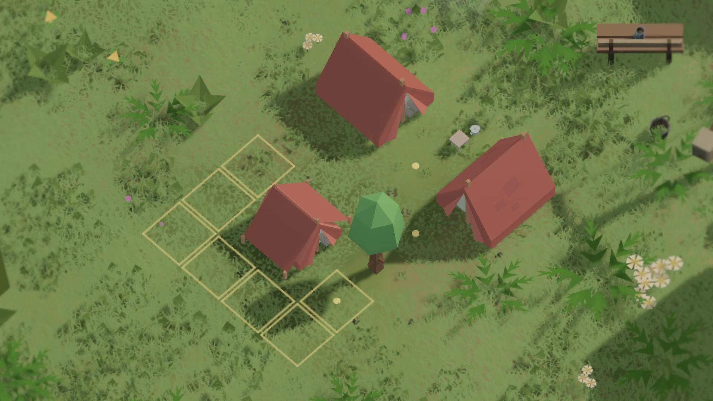

# QuietCamp V03 — Gameplay Review

Створено три різні шестисекундні вступи, окремий rough та новий 16-секундний
монтаж одного справжнього пазла. V03 починається поворотом намету, показує
розміщення, тінь і прохід та завершується канонічною перевіркою табору.
1920×1080, 30 fps, H.264, звук Unity, без тексту, логотипів і голосу.

**Статус Review, 3.275/5: до художнього Final не дотягує.** Значення підсвіток
та завершення ще недостатньо зрозуміле новому глядачеві; маршрут у двох
сусідніх планах повторюється. Технічна справність не замінює ці вимоги.

Відео локально: `QuietCamp/Marketing/Exports/v03/Delivery/`:
`QuietCamp_Hook_A.mp4`, `QuietCamp_Hook_B.mp4`, `QuietCamp_Hook_C.mp4`,
`QuietCamp_V03_RoughCut.mp4`, `QuietCamp_V03_Review.mp4`.
ZIP: `QuietCamp/Marketing/Exports/v03/QuietCamp_V03_Review_Package.zip`.
Відеофайли не додаються в Git; редаговані Unity-assets та докази перегляду додаються.

- [Головна ідея й аудит](../../../../QuietCamp/Assets/Marketing/TeaserV03/GAME_HOOK_ANALYSIS.md)
- [Три концепції](../../../../QuietCamp/Assets/Marketing/TeaserV03/THREE_CONCEPTS.md)
- [Порівняння записаних вступів](../../../../QuietCamp/Assets/Marketing/TeaserV03/HOOK_COMPARISON.md)
- [Банк матеріалу](../../../../QuietCamp/Assets/Marketing/TeaserV03/FOOTAGE_INVENTORY.md)
- [Storyboard](../../../../QuietCamp/Assets/Marketing/TeaserV03/DIRECTOR_STORYBOARD.md)
- [EDL і зміни rough → fine](../../../../QuietCamp/Assets/Marketing/TeaserV03/EDIT_DECISION_LIST.md)
- [Переходи та звук](../../../../QuietCamp/Assets/Marketing/TeaserV03/TRANSITION_DESIGN.md)
- [QA: факти, оцінки й усі десять gates](../../../../QuietCamp/Assets/Marketing/TeaserV03/QA_REPORT.md)
- [Повторний запис і пакування](../../../../QuietCamp/Assets/Marketing/TeaserV03/REPRODUCTION_GUIDE.md)

`Hooks/`, `Rough/`, `Review/` містять актуальні контактні аркуші та машинні
пакети відповідних версій. Незалежного тесту глядачами не було. V01/V02,
кампанію й локальний прогрес збережено.
