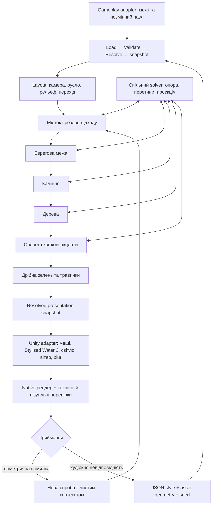

# Генерація табору: правила, системи та межі перевірки

Мета — автоматично відтворювати композиційну мову QC007 на різних полях і seeds.
Генератор не змінює пазл, свідок розв'язання, progression або збереження.
AI-концепт є художнім референсом; піксельна тотожність йому не досягнута і не
випливає з проходження тестів. Точне повторення **плану генератора** є окремим,
перевіреним контрактом: однакові код, профіль, геометрія, розміри та seed.

## Вибрані GitHub-репозиторії

| Репозиторій | Відповідальність | Фактично використано |
|---|---|---|
| [scene-placement](https://github.com/kruty1918dev-ai/scene-placement) | Єдиний solver контакту/перетинів; композиційний layout і порядок систем | Додано переносне ядро, захищену проєкцію, перехід, берегову межу та повторні спроби |
| [vegetation-placement](https://github.com/kruty1918dev-ai/vegetation-placement) | Екологічні поля, стабільні клітини, види, розмір, spacing | Додано woodland/shoreline stages, діапазон yaw, дрібний groundcover і перевірку структурних перетинів |
| [rock-placement](https://github.com/kruty1918dev-ai/rock-placement) | Берегові групи каміння, контакт і осідання | Додано генерацію груп із layout та явний режим без нахилу для planar adapter |
| [atmos](https://github.com/kruty1918dev-ai/atmos) | Фази дня, палітра й атмосфера | Наявна залежність QuietCamp; новий профіль погоджує authored sun із поточним wind/life runtime |
| [gameplay-viewport](https://github.com/kruty1918dev-ai/com.kruty1918.gameplay-viewport) | Придатна область gameplay, пропорції, safe area | Наявна інтеграція; CameraFitter застосовує композицію до доступного viewport |
| [agentverify](https://github.com/kruty1918dev-ai/agentverify) | Перевірки Unity | Наявний toolkit; для цього етапу використано окремий command capture helper у вже відкритому Editor |

`fence-authoring` придатний для багатосекційних огорож із власними стовпами,
сокетами й воротами. Тут використовується готова цілісна модель тину через
`BankBoundaryStage`; удаваної інтеграції FenceGenerator немає. `road-authoring`
стане потрібним для прохідної дорожньої мережі. `power-lines` не належить цьому
біому. `mesh-style`/`model-weathering` — можливі asset preprocessing adapters,
їхній код для цього генератора не змінювався. `levelgen` може постачати gameplay
іншої гри; ця система приймає вже готову захищену область, а не вигадує її правила.

## Джерела даних

- `ArtCompositions/Profiles/riparian-clearing.json`: розміри відносно поля,
  камера, світло, палітра, щільність видів, орієнтація, дрібні деталі й бюджети.
- `ArtCompositions/CampModelLibrary.json`: геометрія шести реальних авторських
  моделей. Це бібліотека асетів без координат сцени.
- `ArtCompositions/QC007.json`: лише `profile` та `seed`, без instances.
- `AssetCatalog`: стабільні ID існуючих префабів. Adapter обчислює реальні
  об'єми з мешів і transforms префаба, а не підставляє умовний радіус дерева.
- `QC007Water.mat`: окремий preset матеріалу **Stylized Water 3**, який зберігає
  посилання на vendor shader, normals, foam, caustics і wave lookup table.

`tools/prepare_qc007_art.py` тепер експортує тільки geometry library і material
preset. Розміщення виконується C#, у Python немає списку координат цього рівня.

## Взаємодія систем



## Правила композиції

1. **Gameplay має пріоритет.** Резервується не лише площина, а й висотна призма
   з запасом. Об'єм декору не перетинає її. Проєкція крон/силуетів також не
   закриває захищену область, навіть якщо стовбур стоїть за межами поля.
2. **Камера залежить від поля.** Pitch/yaw належать стилю; orthographic size
   виводиться з проєкції всіх країв поля, висоти головних об'єктів і aspect.
   Fit viewport збільшує рамку для вузьких екранів. Центр gameplay залишається різким.
3. **Водойма має географію.** Базовий відступ русла враховує всі кути поля,
   його нахил, ширину і максимальний вигин. Дно нижче берега; берег переходить
   до низького рельєфу. Water mesh та terrain використовують той самий базис.
4. **Місток належить берегам.** Масштаб походить із ширини русла та довжини
   моделі. Два контакти повинні підтримуватися берегами. Підхід резервується
   перед камінням і рослинами. Тин розташовується відносно переходу, а не точки QC007.
5. **Масштаб деталей має ієрархію.** Дерева формують раму; кущі та очерет
   насичують берег; травинки зв'язують землю й більші рослини; квіти займають
   малу частку, задану профілем. Великі акценти розміщуються раніше дрібних.
6. **Рослини відповідають середовищу.** Вологість зменшується з відстанню від
   водойми. Щільність змінюється плямами, а не рівномірним шумом. Соняшники
   мають yaw range для читабельних квітів. Groundcover не проростає через
   структурні об'єми каміння, містка або дерев і не займає landing.
7. **Світло одне для сцени.** Реальний sun використовується і native мешами,
   і shader globals атмосферної системи. Камеру наближено без зміни масштабу
   ортографічного кадру, щоб сцена входила в наявну shadow distance. Матеріал
   ground/foliage приймає тіні; foliage має помірне заповнення зворотного боку.
8. **Життя не змінює правила пазла.** Groundcover sway використовує спільний
   вітер, Stylized Water 3 анімує воду. Наявні CampAtmosphere/CampSoundscape/life
   системи продовжують працювати. Reduced motion залишається власником вітру;
   generator не заводить незалежний таймер руху.
9. **Відхилення — нормальний результат.** Optional accent може не розміститися.
   Відсутність обов'язкового містка/мінімуму habitat запускає нову спробу.
   Після ліміту повертається явна помилка. Чужий save ніколи не виправляє scenery.
10. **Пікселі перевіряються окремо.** Geometry `Ok` не означає «шедевр».
    Потрібно переглянути native кадр цілком і фрагменти берега, переходу,
    крон, тіней та рослинності. Художній feedback змінює профіль/алгоритм,
    а не ручні координати одного рівня.

## Як згенерувати інший рівень

```csharp
var art = CampCompositionGenerator.Generate(level, "riparian-clearing", seed, out var plan);
// level — готовий gameplay; art — його окрема presentation snapshot.
```

Для native preview запишіть у `Temp/ai/qc007-art-request.json` відкритого
QuietCamp Editor запит `mode: capture`, `levelId`, `profile: riparian-clearing`,
`seed`, `width`, `height`, `name`, `output`. Helper не запускає новий Unity
і не збирає player. На QC001/QC009 профіль показано через preview; їхню
звичайну presentation не перепубліковано в Resources.

## Приймання й переносність

Core contracts перевіряють різні розміри/seed, підтримку двох кінців мосту,
детермінізм, захищену проєкцію, habitat/landing exclusions, candidate budgets,
скасування й структурні перетини дрібної зелені. Unity EditMode додатково
перевіряє реальні asset shapes, повторення snapshot, зміну seed та незмінний пазл.
Native receipts фіксують рівень, seed, профіль, PNG SHA-256, resolved snapshot
SHA-256 і hashes задіяних джерел. Старі AI/ручні кадри не є цими receipts.

Цільові рендери — Unity world camera; gameplay smoke перевіряється окремо.
Продуктивність мобільного player не виміряна, player builds не виконуються.

Переносне ядро підтримує прямокутну gameplay область, ортографічний layout
і висотну поверхню. Інша гра замінює gameplay adapter, бібліотеку форм, JSON
style та rendering adapter. Для perspective, печер або довільної топології
потрібен інший layout/protection rule, а не копія QuietCamp координат.
Stylized Water 3 залишається залежністю конкретного Unity adapter; переносне
ядро не містить vendor shader або ліцензованих текстур.

?? generated ????? BoardRenderer ?? ??????? ????????? legacy shade-canopy ??????. Shade masks ?? rule UI ???????? gameplay, ? scenic trees ? composition generator. ?? ?????? ?????? ???????, ???? ??? ????????? ?????.
