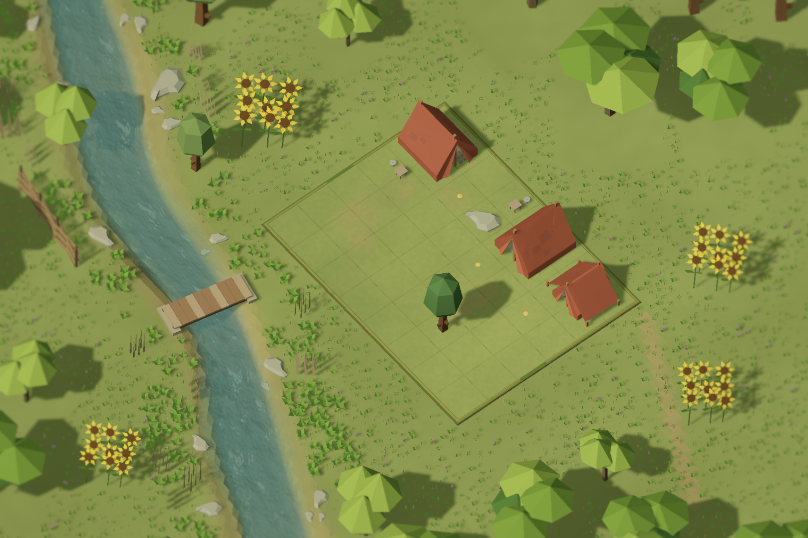

# Повторний перегляд річки та композиції — 12 жовтня 2026

Проведено дев’ять основних циклів правок і два додаткові повтори невдалого
четвертого циклу. У кожній серії знято й переглянуто всі чотири кадри:
QC007 landscape, QC007 portrait, QC001 і QC009. Разом — 44 native PNG
з індивідуальними JSON receipts. Фінальна серія — **R09**.
Невдале забілення води збережене як відхилений результат, а не прийнятий кадр.

Це реальні Unity world-camera renders production components, без домальовування.
QC007 використовує профіль у грі; QC001/QC009 показують той самий генератор через
preview override. Їхній звичайний вигляд у кампанії не перепубліковувався.

## Останні кадри

| Кадр | Рендер | Receipt |
|---|---|---|
| QC007, 1536×1024 | [Відкрити](R09/QC007-landscape.png) | [JSON](R09/QC007-landscape.json) |
| QC007, 864×1536 | [Відкрити](R09/QC007-portrait.png) | [JSON](R09/QC007-portrait.json) |
| QC001, 1536×1024 | [Відкрити](R09/QC001.png) | [JSON](R09/QC001.json) |
| QC009, 1536×1024 | [Відкрити](R09/QC009.png) | [JSON](R09/QC009.json) |

## Покадрові цикли

Кожний рядок описує правку після огляду попередньої серії та те, що залишилося
видимим у новому результаті. Нижчі числові оцінки не вважалися автоматично
гіршими зображеннями: critic оцінює геометрію, а не художню відповідність.

| Цикл і внесена правка | QC007 landscape | QC007 portrait | QC001 | QC009 |
|---|---|---|---|---|
| [R01](R01/QC007-landscape.png): змінна ширина, сильніший вигин, орієнтація мосту за течією | Стрічка стала менш рівною; два ряди великих каменів ще домінують | Довга річка підсилює повторюваність каміння | Великі камені майже однакового розміру | Вода однорідна, квіти темні |
| [R02](R02/QC007-landscape.png): мілководна полиця, нижча вода, дрібніша геометрія, ширша зелена смуга | Берег отримав об’єм, але піщана смуга надто рівна | Суцільний береговий пояс особливо помітний | Зелені кущі утворюють занадто щільну лінію | Прибережна зелень читається, камені ще повторюються |
| [R03](R03/QC007-landscape.png): пропуски й незалежний ритм берегів, різні масштаби, групи малих камінців | Великі повторні камені прибрані; вода ще пласка | Ритм каміння різноманітніший, берег довгий і рівний | Групи читаються краще, фактура води надто дрібна | Менше кам’яного шуму; соняхи й тин не читаються |
| [R04 — відхилено](R04/QC007-landscape.png): палітра, масштаб хвиль, піна та густіша водна сітка | Піна забілила всю воду | Біла стрічка неприйнятна | Вода втратила глибину | Піна знищила колір русла |
| [R4b — відхилено](R4b/QC007-landscape.png): піна й глибина через vendor vertex channels | Забілення залишилося | Ефект маски неправильний по всій довжині | Зміна джерела градієнта недостатня | Потрібна перевірка фактичних значень масок |
| [R4c](R4c/QC007-landscape.png): виправлення семантики Unity SmoothStep | Вода знову синьо-зелена, але світлий край суцільний | Глибина читається, берегова піна ще надто рівна | Великі хвилі кращі за попередній дрібний шум | Забілення прибране; соняхи ще темні |
| [R05](R05/QC007-landscape.png): нахил і збільшення дисків соняхів, палітра, foliage material, захищений habitat | Соняхи видно праворуч; лісова рамка має великі прогалини | Квіти впізнаються, хоча менші через формат | Видно жовті пелюстки й темні серединки | Квіткові групи читаються; модель повторює дев’ять стебел |
| [R06](R06/QC007-landscape.png): площина паркану повернута до камери, перенесення на сухий зовнішній берег, обов’язкова visible role | Плетіння видно; край паркану близько до межі кадру | Тин уже не тонка риска; рослини повторюють великі групи | Паркан читається, але світло плоске | Видно тин і соняхи; тіні займають забагато порожньої галявини |
| [R07](R07/QC007-landscape.png): верби, густіша рамка, тепле світло, прогалини рослин, стримана піна | Квіти й намети світліші, берег ще надто регулярний | Більше силуетів дерев, поле залишається відкритим | Освітлення краще відокремлює об’єкти | Соняхи видимі, відкрита земля ще простіша за референс |
| [R08](R08/QC007-landscape.png): спільна RiverGeometry, асиметричний берег, діагональний міст, волога палітра, стежка від меж поля | Міст діагональний; тин частково притиснутий до лівої рамки | Вигини читаються краще; дрібні деталі менші | Поворот мосту наблизив композицію до референсу | Зник прямий горизонтальний перетин; залишилася проблема запасу камери |
| [R09](R09/QC007-landscape.png): запас камери для берегових акцентів, довжина мосту по перпендикуляру | Видно площину паркану й жовті квіти, каміння різного масштабу | Паркан, міст і квіти присутні; поле менше через збереження оточення | У кадрі і паркан, і кілька квіткових груп | Збережена читабельність наметів, вогнища й акцентів |

Під час R08 виявлено відсутнє посилання Presentation assembly на переносиме ядро.
Початковий кадр зі старою завантаженою збіркою не зараховувався; серію R08
перезнято після виправлення. Захоплення тепер відмовляється працювати при
`EditorUtility.scriptCompilationFailed`. Фінальні receipts містять MVID і SHA-256
Presentation/Infrastructure assemblies, хеші профілю, моделей, prefab dependencies,
шейдерів, renderer та PNG. CLI ігнорує помилку від попереднього запиту.

## Порівняння з референсом, об’єкт за об’єктом

Референс: [QC007-concept.png](../../../LevelVisualConcepts/2026-10-12/QC007-concept.png).

| Елемент | Було в Reviewed | Тепер | Залишкова відмінність від референсу |
|---|---|---|---|
| Річка | Майже постійна ширина, дрібний рівномірний шум | Вигини, змінна ширина, глибина й мілководний край, справжній Stylized Water 3 | Референс має виразніші великі фасетні плями кольору |
| Берег | Вузька лінія стику й ряд однакових каменів | Поперечний профіль з полицею, нерівномірна волога палітра, групи й прогалини | Перехід землі все ще простіший за намальований референс |
| Каміння | Два ряди великих екземплярів однієї форми | Різні розміри, повороти, супутні камінці, пропуски | Джерельна форма каменю одна; це варіація розміщення, не нові моделі |
| Міст | Майже горизонтальний | Діагональний, напрям від похідної русла, опори на берегах | Кількість дощок і форма source model відрізняються від concept |
| Паркан | Показаний ребром | Видиме плетіння й власна тінь, гарантована visible role | Тин на зовнішньому березі, тоді як у concept він на внутрішньому |
| Соняхи | Маленькі темні риски | Жовті пелюстки, темний диск, нахил до камери, захищені групи | Дев’ять стебел source patch утворюють регулярнішу групу |
| Дерева | Великі прогалини, дві форми | Додано наявну вербу, три типи силуетів, густіша рамка | Concept має щільніший і детальніший ліс |
| Дрібна зелень | Окремі дрібні плями на пласкій землі | Два масштаби, вологий habitat, прогалини, об’ємні кущики | Для окремих стебел у portrait бракує пікселів |
| Світло й тіні | Темні фронти квітів/наметів, великі порожні тіні | Теплий напрям світла, читабельні фронти та контакт із землею | Атмосферне розсіювання concept сильніше |
| Камера й розмиття | Прямий міст, обрізані акценти | Спільна постановка з запасом для берега; protected edge blur | Portrait свідомо показує більше оточення й менше поле |

**Не заявляю піксельну ідентичність або повне відтворення concept.** Основні
помилки видимості виправлені; таблиця вище фіксує те, що ще не відповідає зразку.
Числовий critic score не вимірює цієї відповідності.

## Джерела та перевірки

Для річки використано первинну документацію автора:
[River mode](https://staggart.xyz/unity/stylized-water-3/sw3-docs/?section=river-mode-2)
про mesh UV, нормалі й tangents,
[Vertex colors](https://staggart.xyz/unity/stylized-water-3/sw3-docs/?section=vertex-colors-4)
про канали піни/глибини,
[Waves](https://staggart.xyz/unity/stylized-water-3/sw3-docs/?section=waves-2)
про вплив густоти вершин на хвилі. Маски перевірено також проти фактичного
vendor shader source; його код і renderer assets не змінювалися.

- 8552 Core assertions: форма русла, похідна, суха підтримка берега,
  незростання глибини до суші, різні масштаби каміння, супутники, replay.
- Два переносимі профілі проходять deterministic replay без Unity/QuietCamp.
  Industrial sample розріджено через надлишок видимих колон, а не зниження порогів.
- 21 Unity EditMode-тест: чотири розміри поля, пазл/witness, replay, critic,
  native water mesh, непорожня берегова маска і відсутність піни в глибокому руслі.
- Canonical source compiler check з Editor і player-conditioned source check пройшли.
  Це не player build і не вимірювання мобільного FPS.
- Menu → Camp/QC007 запущено в уже відкритому Editor; live camera відповідає
  композиції. Потім Play Mode зупинено, попередні QA saves відновлено.

Кадри походять із відкритої QA-копії. Її QC007 content hash:
`7d54113d6df37600c093ababc533f3a4fa0af4fc80d2217232f903d23d718eca`.
Canonical QC007 hash залишено:
`24f155ac8a3082e20fc343c92711f147141710a9e0519544c7714bcad3b03970`.
Пазли не синхронізувалися поверх різних історичних baseline; код, профіль,
матеріал води й переносимі пакети синхронізовані в обидві копії.

Зміни переносимих систем опубліковані окремо:
[scene-placement 0ea952e](https://github.com/kruty1918dev-ai/scene-placement/commit/0ea952e),
[vegetation-placement 0cfb74f](https://github.com/kruty1918dev-ai/vegetation-placement/commit/0cfb74f),
[rock-placement d4ce054](https://github.com/kruty1918dev-ai/rock-placement/commit/d4ce054).
