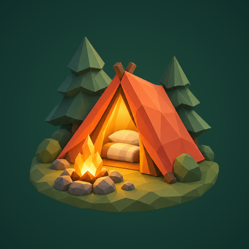
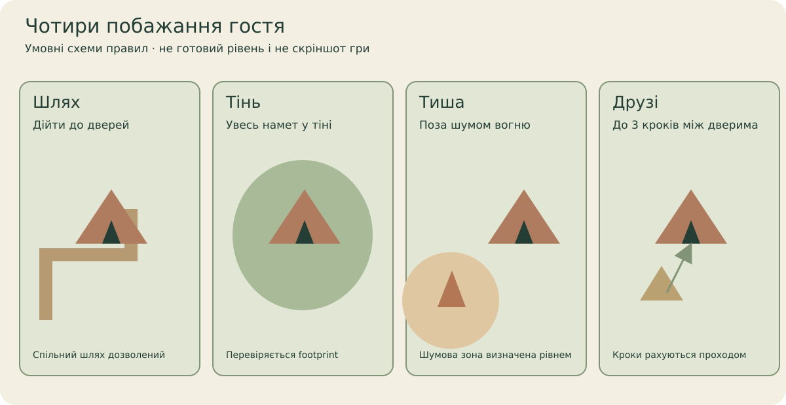

<p align="center">
  
</p>

<h1 align="center">Quiet Camp · Тихий кемпінг</h1>

<p align="center"><strong>Місце для кожного гостя. Табір, до якого хочеться повернутись.</strong><br>
Затишна просторова головоломка про подорож українськими краєвидами, турботу й життя після війни.</p>

<p align="center">Unity 6 / URP · Offline-first · Українська / English / Deutsch</p>

<p align="center">
  <a href="https://kruty1918dev-ai.github.io/quiet-camp/">Ілюстрований сайт</a> ·
  <a href="https://kruty1918dev-ai.github.io/quiet-camp/campaign100/">Кампанія: 100 рівнів</a> ·
  <a href="docs/development.md">Відкрити проєкт</a> ·
  <a href="docs/gameplay.md">Як грати</a> ·
  <a href="docs/status.md">Стан перевірок</a>
</p>


Справжній кадр із 42-секундного тизера V02: 13 планів, реальні розміщення й поворот намету, дощ зблизька та відкриття Гавані. [Монтаж, відтворення та перевірки](Design/Marketing/Teaser/V02/README-UA.md), [порівняння V01/V02](Design/Marketing/Teaser/V01_V02_COMPARISON.md). HUD приховано лише для маркетингового запису; V01 збережено окремо.

[V03: новий gameplay-прототип, три вступи та 16-секундний монтаж](Design/Marketing/Teaser/V03/README-UA.md).
Статус **Review**: технічні перевірки пройдені, художні критерії ще не досягли 4/5.
V01/V02 залишаються окремими версіями.

## Кандидат приватності та дитяча аудиторія

Підготовлено privacy7 для основної аудиторії13+: послідовні незалежні вибори, добровільні відео за життя/підказку, повільне відновлення життів, окремі NPA/Teen та допуск LTD. Немає миттєвого безмежного безкоштовного продовження або загальної заборони реклами до18. Продажі Pro та неперевірені виробничі SDK не активовано. Це кандидат, не допуск Android-релізу. [Інтеграція](docs/privacy-integration.md), [реалізація й перевірки](reports/monetization-review/IMPLEMENTATION-UA.md), [аудит доходу](reports/monetization-review/AUDIT-UA.md).

## Що зараз у main

Сезонні ефекти оптимізовано без зменшення тіней, звуку, геометрії чи кількості частинок: прибрано кадрові замикання, проміжні масиви під час фільтрації моделей і дублікати однакових текстур. Збіг геометрії, частинок та зображень перевірено до/після у QA Unity; 43 EditMode та 19 PlayMode перевірок пройдено. Це перевірки редактора, мобільний приріст FPS ще не виміряно. [Відтворення перевірок](docs/development.md#оптимізація-без-зміни-якості).

Для ручного створення таборів додано **Quiet Camp → Майстерня рівнів**: навігація Odin, галерея 100 рівнів, розширена палітра й пензлі PWB, спільна крива річки River Modeler/MicroVerse, пагорби, гості, перевірка, JSON-чернетки та експорт. [Офлайн-інструкція з картинками](Design/LevelAuthoring/index.html), [встановлення локальних асетів](Design/LevelAuthoring/INSTALL-UA.md).

Спільне оформлення річок використовує фактичне русло, природні береги, сезонні контакти опадів і відображення сцени через Stylized Water 3. [Ігрове порівняння води до/після](Design/LevelAuthoring/RiverGuide/index.html) та [реалізація й стан перевірок](Design/LevelAuthoring/RiverGuide/README-UA.md).

Базова кампанія містить **рівно 100 рівнів у 10 розділах**. Навчання поступово знайомить із керуванням, проходами, тінню, тишею й дружбою. Далі знайомі правила поєднуються в нових таборах; погода й сезони змінюються плавно. Покинуті садиби, сліди евакуації, розбитий літак і осушений ставок розповідають історію через оточення.

Усі 100 рівнів мають застосовані редаговані композиції з різними головними моделями, власними сюжетними деталями й сезонним оформленням. Виконано сім художніх раундів правок, 164 EditMode-тести та автоматичне проходження всіх 100 рівнів через звичайні «Перевірити» й «Далі» — 99 переходів без зміни збереженого прогресу. [Актуальна офлайн-галерея з кадрами гри](Design/LevelAuthoring/StoryCampaign/index.html) містить історії, нативні композиції та знімки з інтерфейсом. Перевірка автоматична; мобільний FPS і зручність для новачків не вимірювалися.

Роадмапу **відкладено й виключено з player**. Почати / Продовжити відкриває рівень напряму; після перемоги можна перейти до наступного. Геометрія та авторинг збережені в [Editor-архіві](Design/Roadmap/Paused/2026-10-11/README-UA.md).

Попередні 274 ревізії контенту збережені для сумісності з альбомом і старими сесіями. Нові місця можна підключати версійованими [пакетами даних](Design/Campaign100/2026-10-11/CONTENT-PACKS-UA.md); мережевий каталог і доставка нових art-ресурсів ще не підключені.

Після перегляду переробки **відновлено стару реалізацію QC001–QC010** за вказівкою користувача 12.10.2026. [HTML-звіт](Design/Campaign100/2026-10-11/FirstTenRefinement/index.html) показує відновлений варіант і двадцять архівних native кадрів відкладеного експерименту. Його запечені ресурси прибрано з gameplay Resources; джерела й вісім універсальних інструментів збережені для майбутньої роботи. [Контракти інструментів](Design/Campaign100/2026-10-11/FirstTenRefinement/TOOLS-UA.md) та [квитанція відновлення](Design/Campaign100/2026-10-11/FirstTenRefinement/rollback-receipt.json).

## Як грати

Обери гостя, перетягни й поверни його намет. Залиш прохід до дверей, врахуй побажання щодо тіні, тиші й сусідів. Undo / redo допомагають спробувати інше розташування. Таймера завершення немає.



Завершені табори лишаються в **Моїх кемпінгах**: їх можна роздивлятися, обертати й проходити повторно. Text scale, contrast, reduced motion, calm pacing, звук і haptics допомагають грати у власному темпі. [Правила й керування](docs/gameplay.md) · [Екрани й налаштування](docs/screens.md).

**Quiet Camp** is a calm, offline-first campsite puzzle set in a recovering Ukrainian world. Arrange tents around paths, shade, quiet and friendship. All 100 campaign levels now have editable, reviewed compositions with unique main landmarks. Seven art correction rounds, 164 EditMode tests and a full automated Check/Next campaign run are recorded in the [current gallery](Design/LevelAuthoring/StoryCampaign/index.html). This is Editor evidence, not measured mobile performance or novice usability. The level-path screen remains excluded from gameplay and Editor Play Mode; its source backup is retained in commit 5035e856. The scene generator uses shared rules for framing, crossings, Stylized Water 3, vegetation, weather and living ground surfaces.

## З чого почати

| Завдання | Вхід |
| --- | --- |
| Подивитися всі нові рівні | [Онлайн-звіт](https://kruty1918dev-ai.github.io/quiet-camp/campaign100/) або [локальний HTML](Design/Campaign100/2026-10-11/index.html): сцени, пояснення, сезони, механіки й каталог моделей. |
| Розібрати сюжет та авторинг | [План](Design/Campaign100/2026-10-11/PLAN-UA.md), [сюжет](Design/Campaign100/2026-10-11/STORY-UA.md), [механіки](Design/Campaign100/2026-10-11/MECHANICS-UA.md). |
| Запустити гру в Editor | [Перший запуск](docs/development.md#перший-запуск). |
| Знайти систему або файл | [Карта проєкту](docs/project-map.md), [Design](Design/README.md), [технічні документи](Documentation/README.md). |
| Перевірити готовність | [Стан і докази](docs/status.md), [продуктивність](PERFORMANCE_MAP.md), [правила workspace](AGENTS.md). |
| Переглянути історичний інтерфейс | [Ілюстрований довідник](docs/README.md), [галерея](docs/gallery.md). |
| Перенести проєкт | [Передача 09.10.2026](docs/TRANSFER-2026-10-09-UA.md) — історичний пакет, не заміна актуального main. |

## Відкрити локально

1. Клонуй репозиторій та використовуй **Unity 6000.6.2f1**, revision `770e33f6875c`.
2. З кореня виконай `python3 tools/verify_portability.py` (Windows: `py -3 tools/verify_portability.py`).
3. Додай папку **QuietCamp/** у Unity Hub; дочекайся імпорту й відновлення packages.
4. Відкрий `Assets/QuietCamp/Scenes/Boot.unity` і запускай Editor Play Mode відповідно до [workspace rules](AGENTS.md).

Embedded UPM packages включені в [Packages](QuietCamp/Packages/README.md). Для першого відновлення registry / Git packages потрібен інтернет; чужа Library не потрібна. Для автономних перевірок потрібні Python 3 і .NET SDK 10.

```sh
python3 tools/verify_portability.py
dotnet build tools/MonetizationProbe.csproj -m:1 -p:UseSharedCompilation=false
dotnet run --no-build --project tools/MonetizationProbe.csproj
python3 tools/verify_github_docs.py
```

[Повний workflow перевірок і підготовки контенту](docs/development.md). Player builds та APK/AAB не входять у поточну роботу.

## Межі готовності

Проєкт у розробці. Покупки, Pro, життя, підказки й обмін валюти мають локальні prototype contracts; реальні store purchases, виробнича рекламна мережа та backend не активовані. Google sample rewarded ads доступні в development після вікового вибору й окремого дозволу. Новий профіль починає з трьох підказок і п’яти життів. Mobile FPS, звук на пристроях і store release не заявляються.

Галереї 05–10.10.2026 — історичні докази конкретних ревізій. [Результати оптимізації 09.10](PERFORMANCE_MAP.md) не замінюють вимірів нової кампанії. Повна історія гілок об’єднана в main: [receipt 10.10](docs/maintenance/2026-10-10-main-consolidation.md).

Art, audio й vendor assets зберігають власні умови ліцензування. [Ліцензії та provenance](docs/development.md#assets-і-ліцензії). Повні vendor model previews зберігаються локально.

У майстерні — [20 сезонних пресетів із прев’ю](Design/LevelAuthoring/SeasonAtmosphere/index.html), п’ять помічників рослинності й чотири основні розділи. Усі 100 пазлів мають редаговані композиції. Нові соняхи мають метричні пропорції; сезонні моделі відновлюються при зміні пресету.

## Приватність і Google SDK

У main об’єднано privacy-гілки: Firebase Core/Analytics/Crashlytics 14.0.0, AdMob 11.6.0, вікові категорії й незалежні дозволи від 16 років. Політика en/uk/de має ревізію 2026-10-21.privacy-4; підтвердження документа не є згодою. Виробничі перевірки залишаються закритими.

[Реалізація, результати перевірок і релізні блокери](Design/Legal/PRIVACY-RUNTIME-UA.md), [облік даних і Data safety](Design/Legal/DATA-SAFETY-UA.md), [зв’язок з офіційним сайтом](docs/privacy-integration.md). Поточні probe-проєкти: tools/privacy-probe та tools/optional-google-probe; платформа/SDK підміняються, перевірки не є Android runtime або player build.
