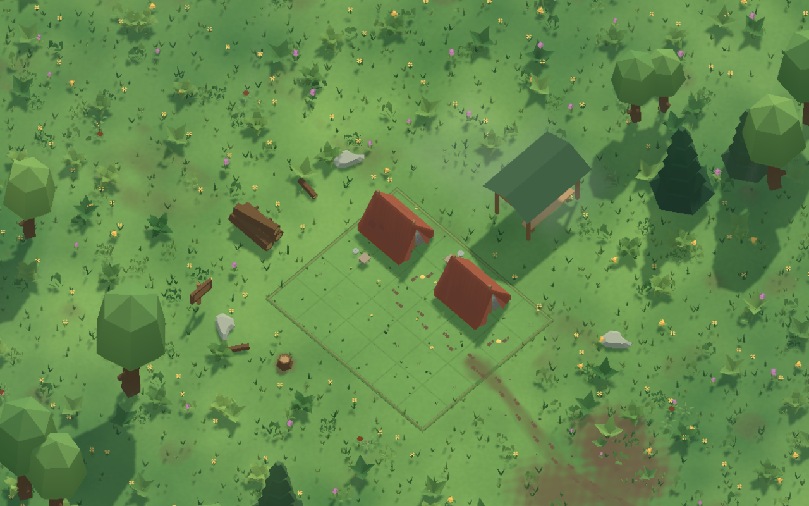

<p align="center">
  
</p>

<h1 align="center">Quiet Camp · Тихий кемпінг</h1>

<p align="center"><strong>Місце для кожного гостя. Табір, до якого хочеться повернутись.</strong><br>
Затишна просторова головоломка про подорож українськими краєвидами, турботу й життя після війни.</p>

<p align="center">Unity 6 / URP · Offline-first · Українська / English / Deutsch</p>

<p align="center">
  <a href="https://kruty1918dev-ai.github.io/quiet-camp/">Ілюстрований сайт</a> ·
  <a href="https://kruty1918dev-ai.github.io/quiet-camp/campaign100/">Кампанія: 100 рівнів</a> ·
  <a href="docs/development.md">Відкрити проєкт</a> ·
  <a href="docs/gameplay.md">Як грати</a> ·
  <a href="docs/status.md">Стан перевірок</a>
</p>



Справжній кадр навчального табору від 11 жовтня; [receipt камери й джерел](Design/Campaign100/2026-10-11/Renders/level-002-landscape.json). HUD перевіряється окремо.

## Що зараз у main

Для ручного створення таборів додано **Quiet Camp → Майстерня рівнів**: навігація Odin, галерея 100 рівнів, розширена палітра й пензлі PWB, спільна крива річки River Modeler/MicroVerse, пагорби, гості, перевірка, JSON-чернетки та експорт. [Офлайн-інструкція з картинками](Design/LevelAuthoring/index.html), [встановлення локальних асетів](Design/LevelAuthoring/INSTALL-UA.md).

Базова кампанія містить **рівно 100 рівнів у 10 розділах**. Навчання поступово знайомить із керуванням, проходами, тінню, тишею й дружбою. Далі знайомі правила поєднуються в нових таборах; погода й сезони змінюються плавно. Покинуті садиби, сліди евакуації, розбитий літак і осушений ставок розповідають історію через оточення.

Усі 100 пазлів пройшли перевірку структури, контрольного розв’язку й незалежного solver. **Художнє та native UI приймання ще триває**: [онлайн-галерея](https://kruty1918dev-ai.github.io/quiet-camp/campaign100/) і [HTML-звіт](Design/Campaign100/2026-10-11/index.html) показують фактичну кількість актуальних кадрів, їхнє походження й незавершені перевірки. Старі кадри мають власні дати.

Роадмапу **відкладено й виключено з player**. Почати / Продовжити відкриває рівень напряму; після перемоги можна перейти до наступного. Геометрія та авторинг збережені в [Editor-архіві](Design/Roadmap/Paused/2026-10-11/README-UA.md).

Попередні 274 ревізії контенту збережені для сумісності з альбомом і старими сесіями. Нові місця можна підключати версійованими [пакетами даних](Design/Campaign100/2026-10-11/CONTENT-PACKS-UA.md); мережевий каталог і доставка нових art-ресурсів ще не підключені.

Після перегляду переробки **відновлено стару реалізацію QC001–QC010** за вказівкою користувача 12.10.2026. [HTML-звіт](Design/Campaign100/2026-10-11/FirstTenRefinement/index.html) показує відновлений варіант і двадцять архівних native кадрів відкладеного експерименту. Його запечені ресурси прибрано з gameplay Resources; джерела й вісім універсальних інструментів збережені для майбутньої роботи. [Контракти інструментів](Design/Campaign100/2026-10-11/FirstTenRefinement/TOOLS-UA.md) та [квитанція відновлення](Design/Campaign100/2026-10-11/FirstTenRefinement/rollback-receipt.json).

## Як грати

Обери гостя, перетягни й поверни його намет. Залиш прохід до дверей, врахуй побажання щодо тіні, тиші й сусідів. Undo / redo допомагають спробувати інше розташування. Таймера завершення немає.


Завершені табори лишаються в **Моїх кемпінгах**: їх можна роздивлятися, обертати й проходити повторно. Text scale, contrast, reduced motion, calm pacing, звук і haptics допомагають грати у власному темпі. [Правила й керування](docs/gameplay.md) · [Екрани й налаштування](docs/screens.md).

**Quiet Camp** is a calm, offline-first campsite puzzle set in a recovering Ukrainian world. Arrange tents around paths, shade, quiet and friendship. The base campaign has 100 levels; visual acceptance is in progress. The level-path screen has been removed from gameplay and Editor Play Mode; its source backup is retained in commit 5035e856. QC007 now uses a deterministic rule-based scene generator with ranked candidate review for camera framing, supported crossings, Stylized Water 3, protected foliage placement and edge blur. [Methodology and fresh native captures](Design/SceneGeneration/2026-10-12/Reviewed/README-UA.md) document the reusable systems, verification and remaining visual differences from the AI concept.

## З чого почати

| Завдання | Вхід |
| --- | --- |
| Подивитися всі нові рівні | [Онлайн-звіт](https://kruty1918dev-ai.github.io/quiet-camp/campaign100/) або [локальний HTML](Design/Campaign100/2026-10-11/index.html): сцени, пояснення, сезони, механіки й каталог моделей. |
| Розібрати сюжет та авторинг | [План](Design/Campaign100/2026-10-11/PLAN-UA.md), [сюжет](Design/Campaign100/2026-10-11/STORY-UA.md), [механіки](Design/Campaign100/2026-10-11/MECHANICS-UA.md). |
| Запустити гру в Editor | [Перший запуск](docs/development.md#перший-запуск). |
| Знайти систему або файл | [Карта проєкту](docs/project-map.md), [Design](Design/README.md), [технічні документи](Documentation/README.md). |
| Перевірити готовність | [Стан і докази](docs/status.md), [продуктивність](PERFORMANCE_MAP.md), [правила workspace](AGENTS.md). |
| Переглянути історичний інтерфейс | [Ілюстрований довідник](docs/README.md), [галерея](docs/gallery.md). |
| Перенести проєкт | [Передача 09.10.2026](docs/TRANSFER-2026-10-09-UA.md) — історичний пакет, не заміна актуального main. |

## Відкрити локально

1. Клонуй репозиторій та використовуй **Unity 6000.6.2f1**, revision `770e33f6875c`.
2. З кореня виконай `python3 tools/verify_portability.py` (Windows: `py -3 tools/verify_portability.py`).
3. Додай папку **QuietCamp/** у Unity Hub; дочекайся імпорту й відновлення packages.
4. Відкрий `Assets/QuietCamp/Scenes/Boot.unity` і запускай Editor Play Mode відповідно до [workspace rules](AGENTS.md).

Embedded UPM packages включені в [Packages](QuietCamp/Packages/README.md). Для першого відновлення registry / Git packages потрібен інтернет; чужа Library не потрібна. Для автономних перевірок потрібні Python 3 і .NET SDK 10.

```sh
python3 tools/verify_portability.py
dotnet build tools/MonetizationProbe.csproj -m:1 -p:UseSharedCompilation=false
dotnet run --no-build --project tools/MonetizationProbe.csproj
python3 tools/verify_github_docs.py
```

[Повний workflow перевірок і підготовки контенту](docs/development.md). Player builds та APK/AAB не входять у поточну роботу.

## Межі готовності

Проєкт у розробці. Покупки, Pro, життя, підказки й обмін валюти мають локальні prototype contracts; реальні store purchases, rewarded ads та backend не підключені. Новий профіль починає з трьох підказок і п’яти життів. Mobile FPS, звук на пристроях і store release не заявляються.

Галереї 05–10.10.2026 — історичні докази конкретних ревізій. [Результати оптимізації 09.10](PERFORMANCE_MAP.md) не замінюють вимірів нової кампанії. Повна історія гілок об’єднана в main: [receipt 10.10](docs/maintenance/2026-10-10-main-consolidation.md).

Art, audio й vendor assets зберігають власні умови ліцензування. [Ліцензії та provenance](docs/development.md#assets-і-ліцензії). Повні vendor model previews зберігаються локально.

У майстерні — [20 сезонних пресетів із прев’ю](Design/LevelAuthoring/SeasonAtmosphere/index.html), п’ять помічників рослинності й чотири основні розділи. Усі 100 пазлів мають редаговані композиції. Нові соняхи мають метричні пропорції; сезонні моделі відновлюються при зміні пресету.
