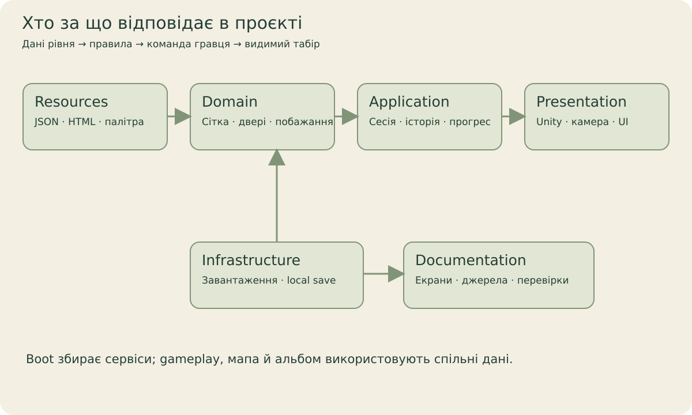

[← Головна](../README.md) · [Довідник](README.md) · [Екрани](screens.md) · [Галерея](gallery.md) · [Розробка](development.md) · [Стан](status.md)

# Відкрити й перевірити проєкт



## Перший запуск

| Потрібно | Версія / дія |
| --- | --- |
| Unity Editor | **6000.6.2f1**, revision `770e33f6875c`; [ProjectVersion](../QuietCamp/ProjectSettings/ProjectVersion.txt). |
| UPM packages | Exact pins у [manifest](../QuietCamp/Packages/manifest.json) і [lock](../QuietCamp/Packages/packages-lock.json); internet для першого resolve. |
| Custom local packages | Embedded у `QuietCamp/Packages/`; сусідні repositories не потрібні. [Upstream revisions/licenses](../QuietCamp/Packages/README.md). |
| CLI tooling | .NET SDK 10 для probe; Python 3 для lightweight checkers. |
| Android modules | Потрібні для Android development; для відкриття/Editor workflow player build не потрібний. |

З кореня repo виконай `python3 tools/verify_portability.py` (Windows: `py -3 tools/verify_portability.py`). Відкрий **QuietCamp/** у Unity Hub, дочекайся package resolution/import, відкрий [Boot.unity](../QuietCamp/Assets/QuietCamp/Scenes/Boot.unity). Gameplay запускається через Boot: він збирає сервіси, policy flow і навігацію. Не починай з порожньої Camp scene без Bootstrap.

Перший import на іншій ОС/host не доводиться статичною перевіркою. При помилці спочатку звір exact Editor, package identity/pins і першу compiler error; не копіюй чужу Library як постійну залежність проєкту.

## Перевірки

Workspace [AGENTS.md](../AGENTS.md) задає актуальні дозволи й host rules. Зараз player builds/APK/AAB та installation не є routine verification. Біля active phone session навіть Editor launch може вплинути на ADB: використовуй погоджений arrangement; не змінюй shared preferences чи чужі процеси.

Послідовно, з кореня repo:

```sh
python3 tools/verify_portability.py
python3 tools/verify_github_docs.py
dotnet build tools/MonetizationProbe.csproj -m:1 -p:UseSharedCompilation=false
dotnet run --no-build --project tools/MonetizationProbe.csproj
python3 tools/verify_monetization.py
python3 tools/test_legal_site.py
```

`verify_portability` не потребує Library. Probe відновлює Newtonsoft.Json через NuGet і не потребує Unity Library. Cached compiler helper потребує реальних Unity Bee responses/reference assemblies після import; він компілює source, але не виконує scene tests. Probe використовує synthetic temporary saves і fake platform providers; список перевірених puzzles дивись у результаті конкретного запуску, не в розмірі всього content catalog.

## Оптимізація без зміни якості

`SeasonModelAppearance` копіює канали відібраних трикутників без окремих LINQ-переборів для кожного трикутника; незмінні сезонні кольори обчислює один раз на модель. `SeasonAtmosphereView` зберігає порядок випадкових вибірок, швидкість, кількість і форму частинок, але не створює функції позиціонування кожного кадру. Постійні параметри шуму задаються під час налаштування; shader property IDs обчислюються один раз. Два незмінні зображення частинок використовуються спільно в межах одного власника; матеріали систем залишаються незалежними й видаляються разом із власником. Планування й параметри звуку збережено, очищення завершених голосів виконується без тимчасових колекцій.

Для повторення використовувати лише дозволений окремий QA Editor із власними збереженнями. `tools/qa/LosslessPerformanceProbe.cs` копіюється у його Editor-каталог. Для продукту `Quiet Camp QA` файл `Temp/LosslessPerformance/request.txt` із `baseline`, `optimized` або `repeat` запускає однакову матрицю: геометрія QC007 для чотирьох сезонів і 24 сценарії нативних частинок із фіксованим кроком, трьома tiers та обома режимами руху. Результати JSON лишаються локально в тому самому Temp-каталозі. Знімати baseline перед копіюванням змінених джерел; перевіряти точний збіг geometry/particle hashes і набору texture hashes. Після PlayMode або оновлення ресурсів повторно знімати обидві реалізації в однаковому стані QA, а не порівнювати лише з давнім записом іншої сесії. Зміна кількості однакових текстур очікувана: у цій матриці 15 → 3. Варіанти `baseline-timing` / `optimized-timing` вимірюють лише підготовку моделей довшими серіями. Час редактора та приблизне зростання Mono heap не є мобільним FPS або точними сумарними алокаціями.

Перед повним профілюванням синхронізувати також Resources і відповідні пакети QA, зберігаючи його product/save identity. Наявність лише актуальних C# файлів недостатня: відсутній `QuietCamp/LeafFlight` вмикає резервну CPU-завісу й дає непредставницький профіль переходів на цьому GPU. Драйвер відхиляє такий запуск; `lossless-transitions` перевіряє фактичний шейдер, рух, непрозоре перекриття екрана та повторне використання геометрії.

`tools/qa/PerformanceAuditDriver.cs` у QA Editor приймає `lossless-editor` / `lossless-runtime` / `lossless-transitions` через JSON-запит у системному тимчасовому каталозі `quietcamp-performance-control`. Потрібне ім'я QA-продукту з префіксом `QuietCampPerfQA`; драйвер відновлює попереднє ім'я після завершення. 21.10.2026 в Unity 6000.6.2f1 пройдено 43 EditMode та 19 PlayMode перевірок: канали моделей, незмінність пікселів частинок, сезони, погода, аудіо, тіні/матеріали та GPU-переходи. Виробничі URP/quality/audio assets і дані рівнів ця оптимізація не змінює. Перевірка послідовного стартового діалогу проходить реальні кнопки, залишаючи тестовий вік невідомим та додаткові SDK вимкненими.

У довшому geometry-only порівнянні (9 серій по 20 проходів, медіана на один прохід QC007) весна: 1.627 → 0.552 ms, літо: 1.596 → 0.554 ms, осінь: 2.784 → 0.698 ms, зима: 1.914 → 0.552 ms. Скомпільовані реалізації фільтра перевірено окремо (`filterIlBytes`: 429 → 244), геометричні хеші однакові. Ці значення характеризують конкретне обчислення в Editor; час інших систем і навантаження хоста коливаються, тому відсотки не переносяться на весь кадр чи телефон. Для порівняння зберігати результати до/після локально й повторювати вимірювання на цільовому пристрої перед заявами про FPS.

Фінальний `performance` прогін із джерелами `ba497038` та синхронізованими ресурсами завершився `Passed`: 7627 кадрів, меню, три tiers, повторні переходи, чотири сезони, налаштування й альбом. Записано 7203 ненульові GPU frame samples; завіса перебудувала геометрію 48 разів за сценарій, а не кожного кадру. Сценарій використовує окремі QA-збереження й вимкнені додаткові SDK, після завершення відновлено назву продукту `Quiet Camp QA`. Сирі JSON, NUnit XML та кадри залишаються локальними QA-артефактами; вони не є Android-вимірюванням або новим художнім прийманням рівнів.

## Кампанія зі 100 рівнів

[План і статус](../Design/Campaign100/2026-10-11/PLAN-UA.md) · [HTML-звіт](../Design/Campaign100/2026-10-11/index.html) · [Механіки](../Design/Campaign100/2026-10-11/MECHANICS-UA.md) · [Пакети розширення](../Design/Campaign100/2026-10-11/CONTENT-PACKS-UA.md).

Джерела: `Design/Campaign100/2026-10-11/Authoring/places.tsv` і `tools/build_campaign100_design.py`. Генератор готує дизайн та level drafts, а publisher перевіряє всі пазли перед записом у Resources. Не редагуй generated JSON як єдине джерело істини.

```sh
python3 tools/build_campaign100_design.py
dotnet run --no-build --project tools/MonetizationProbe.csproj -- --author-campaign100 "$PWD"
python3 tools/build_campaign100_report.py
```

Після зміни рівнів старі кадри не зараховуються як актуальні: звіт звіряє content hash, SHA-256 PNG та ревізію коду, шейдерів, матеріалів і конфігурації рендера. Native захоплення виконується одним ізольованим Editor після RAM/disk checks і probe, без player build. World-camera captures перевіряють сцену; Game View окремо перевіряє HUD, навігацію й проходження. Повні фотографії сторонніх моделей залишаються локальними.

У погодженому локальному середовищі, по одному запуску:

```sh
bash tools/render_diorama_editor_isolated.sh --probe
python3 tools/campaign100_capture_sources.py
QC_CAMPAIGN_OFFSCREEN=1 QC_CAMPAIGN_FIRST=1 QC_CAMPAIGN_LAST=100 bash tools/render_diorama_editor_isolated.sh --campaign-tests
bash tools/render_diorama_editor_isolated.sh --campaign-edit-tests
bash tools/render_diorama_editor_isolated.sh --campaign-flow-tests
python3 tools/campaign100_contact_sheets.py
python3 tools/build_campaign100_report.py
python3 tools/verify_campaign100_artifacts.py
```

Після перерваного захоплення можна продовжити з потрібного номера через `QC_CAMPAIGN_FIRST`, якщо джерела не змінилися. `--allow-incomplete` в artifact checker залишає результат **Pending** і перелік відсутніх/застарілих кадрів; це не повне приймання. На цьому ноутбуці 1,5 ГБ є мінімумом для дозволу запуску, але не гарантує, що RAM вистачить до його завершення.

Онлайн-галерея генерується в `docs/campaign100/` з WebP-прев’ю тих самих PNG. Контрольні оригінали й receipts лишаються в `Design/Campaign100/2026-10-11/Renders`. Усі сторонні model photographs вилучені з публічного HTML; локальний каталог зберігає їхні два ракурси. Для browser-перевірки можна передати `--browser-executable` з установленим Chrome замість завантаження окремого Chromium.

## GitHub Pages

Static site живе у `docs/index.html`, `site.css`, `site.js`, `site-content.json` та `site-i18n.json`. Джерело публікації — main `/docs`; `.nojekyll` зберігає site як звичайні static assets. UA/EN/DE перекладають пояснення сайту; native captures гри залишаються українськими.

`python3 tools/verify_github_docs.py` перевіряє links/anchors, усі PNG hashes і metadata та locale coverage. [Browser fixture](../tools/qa/test_github_guide_browser.py) потребує окремого Python Playwright + Chromium середовища; його можна запустити локально або з `--url` для опублікованого сайту. Він перевіряє image loading, пошук/filters, мови, viewer, responsive overflow і fallback без JavaScript. Немає npm install, bundler або external CDN dependency у самому сайті.

## Знімки документації

[Capture workflow](../tools/qa/DOCS-CAPTURE-UA.md) описує guarded `GithubDocumentationCaptureTests`, QA identity та JSON sidecars. Capture потребує rendered Game View, не `-batchmode`. У відкритому Editor можна виконати QA без нового launch; source/settings/player-save hashes перевіряються до й після. Використовуй свіжий QA product і не запускай destructive fixtures на player storage.

[Галерея](gallery.md) зберігає зображення й provenance. [Стан](status.md) відділяє source compilation, native test/capture, player/device checks та staging assets.

## Зміна UI або світу

- Екран: [Атлас](screens.md) → source owner → [HTML UI](../Documentation/HTML-UI.md). Зберігай stable ids, callback routing, safe-area й scroll state.
- Puzzle: редагуй source/content pipeline, перевір правила/solver; не змінюй логічний рівень через decorative props.
- Роадмапу відкладено: її джерела та ресурси зберігаються в Editor-архіві. Не повертай їх у Resources або player dependencies під час підготовки контенту.
- Готовий milestone: онови відповідну docs-сторінку, виконай доречну перевірку, commit і push; концепт не замінює Game View evidence.

## Assets і ліцензії

Code/art/audio/vendor sources мають власні license/provenance records; наявність файлу в repository не надає універсального права на redistribution. Kenney/Poly Haven CC0 notes збережені, DOTween/audio/Stylized Water vendor terms залишаються чинними. [Lighting source](../QuietCamp/Assets/QuietCamp/ThirdParty/PolyHavenLighting/SOURCE.md) · [Water integration](../QuietCamp/Assets/ThirdParty/Stylized%20Water%203/QUIET-CAMP-INTEGRATION.md).
