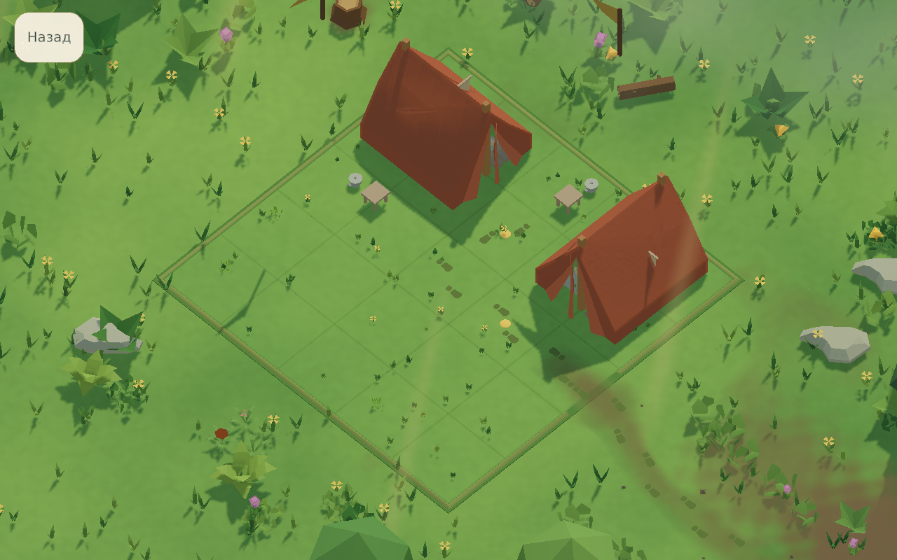
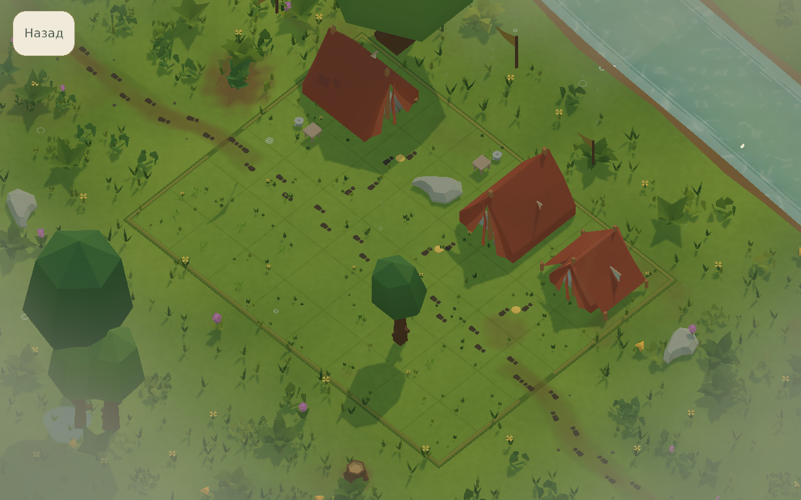
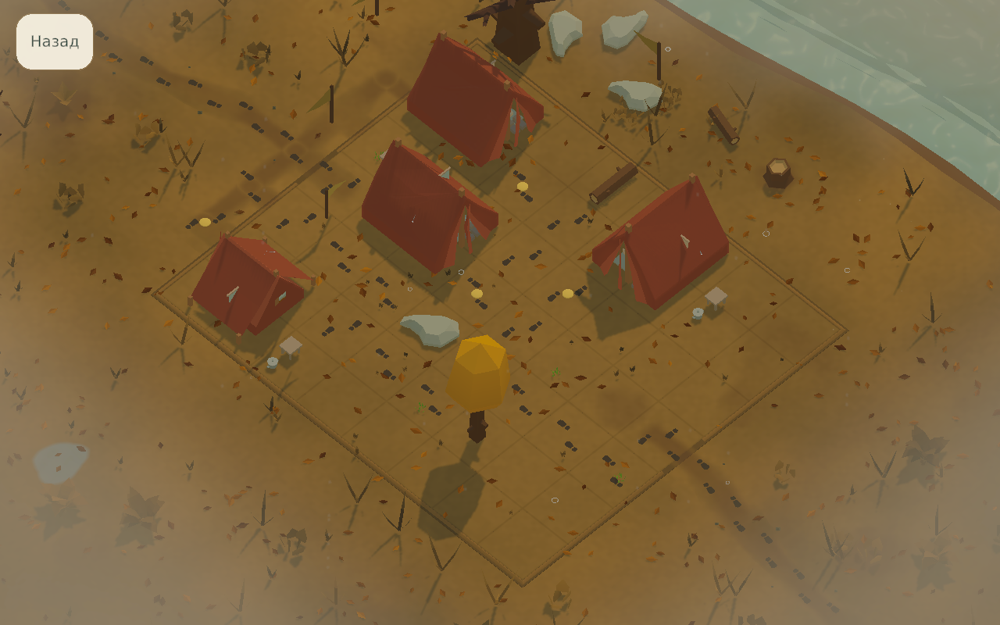
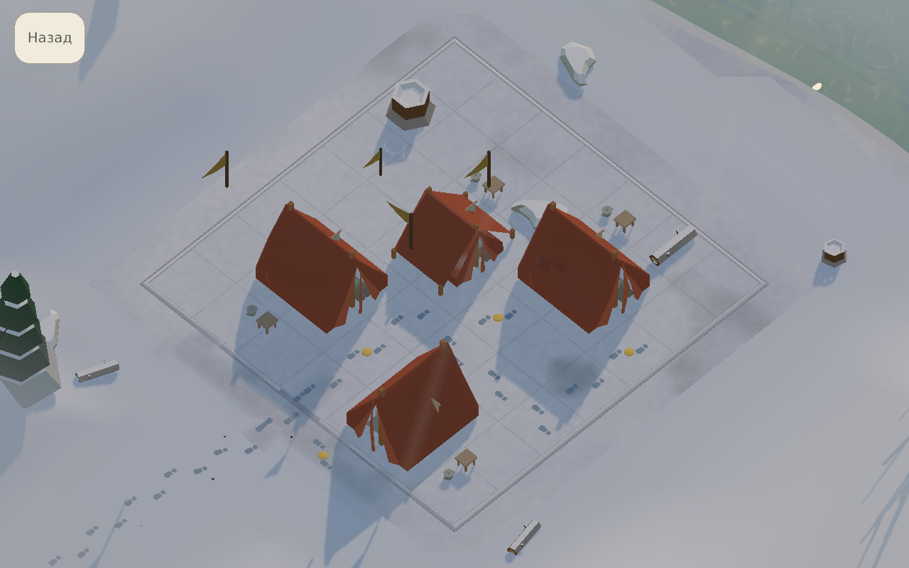

[← Головна](../README.md) · [Довідник](README.md) · [Екрани](screens.md) · [Галерея](gallery.md) · [Розробка](development.md) · [Стан](status.md)

# Світ, сезони й подорожі

Чотири сезони змінюють колір, рослинність, опади й освітлення. Оточення розповідає про місце, а puzzle rules залишаються частиною level data. У campsite gameplay стоять намети гостей; кампанія веде через 100 українських місць, а роадмапу відкладено.

| Весна | Літо |
| --- | --- |
|  |  |

| Осінь | Зима |
| --- | --- |
|  |  |

## Кампанія 100

[Campaign data](../QuietCamp/Assets/QuietCamp/Resources/QuietCamp/campaign.json) задає рівно 100 місць у 10 розділах. [HTML-звіт](../Design/Campaign100/2026-10-11/index.html) містить окремі пояснення сцен, план навчання й поточне native приймання.

| Рівні | Сюжетний відрізок |
| --- | --- |
| 1–10 | Перша весна: безпечна галявина, гості й повернення звичайного маршруту. |
| 11–20 | Садиби, сад і шкільний двір: сліди повсякденності та взаємодопомоги. |
| 21–30 | Криниці, майстерні й волонтерські двори. |
| 31–40 | Залізниця й переправи: пам’ять евакуації та повернення руху. |
| 41–50 | Літак у полі та тихі місця пам’яті. |
| 51–60 | Осушений ставок, пошкоджена гребля й нове русло. |
| 61–70 | Осінні дощі, ремонт і врятована спадщина. |
| 71–80 | Поступовий сніг, лісове укриття й спільне тепло. |
| 81–90 | Відлига, довші дні та перші паростки. |
| 91–100 | Наступна весна, поновлені повсякденні функції й Гавань. |

Сезон і погода мають неперервні параметри, а не випадкове чергування зими й літа. Оточення не додає прихованих правил пазла. [Сюжет і уточнення канону](../Design/Campaign100/2026-10-11/STORY-UA.md) пояснюють, чому ігровий літак та невелика гребля є авторськими місцями, а не реконструкціями конкретних трагедій.

## Додатковий контент і старі збереження

Раніше активні journeys та bonus відкладені: вони не збільшують базову гру понад 100 рівнів. Їхні catalog metadata й 274 попередні ревізії збережені для альбому та сумісності сесій. Наявність архіву не означає, що додаткова подорож доступна для нового запуску.

[Версійовані пакети даних](../Design/Campaign100/2026-10-11/CONTENT-PACKS-UA.md) дають окремі ID, контроль hash, валідності та розв’язності, атомарну установку й відновлення після перезапуску. Вони використовують встановлені gameplay assets. Live CDN / мережевий каталог та доставка нових art-ресурсів ще не налаштовані.

## Відкладена роадмапа

Роадмапу **виключено з player 11.10.2026**. Меню відкриває пазли напряму. Геометрія, ресурси й semantic авторинг збережені в [Editor-архіві](../Design/Roadmap/Paused/2026-10-11/README-UA.md); їх не можна повертати в Resources при routine content preparation.

[Кадри пілота QC001–QC005 від 10 жовтня](../Design/Roadmap/CinematicPilot/2026-10-10/index.html), [12 діорам стилю](../Design/Roadmap/DioramaStudies/2026-10-10/index.html) та [сезонні кадри вище](gallery.md) є історичними й мають власні receipts. Поточні рівні перевіряються окремо.

[Стан доказів](status.md) · [Карта кампанії](../CAMPAIGN_ROADMAP.md) · [Сезонний renderer](../Design/Atmosphere/SEASONAL-RENDERING-UA.md).
