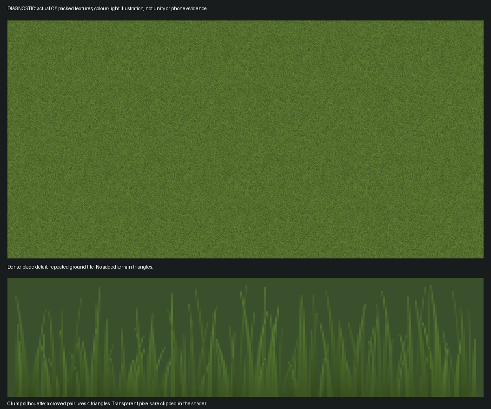

# Густий луг без густої геометрії — етап 2

Напрямок користувача: залишити враження великої кількості зелені, замінивши
полігони візуальною ілюзією. Перший варіант із рідкими трав'яними акцентами
не є затвердженим візуальним результатом. Цей етап додає **detail mapping +
crossed grass cards**, зберігаючи геометричний бюджет попереднього етапу.

## Реалізація

- На існуючу непрозору землю накладається упакована деталізація травинок:
  локальне затінення, відтінок і два компоненти нормалі. Один додатковий
  texture lookup у ground fragment, без додаткового ground draw або меша.
- Контури пучків зображуються на перехрещених картках: 112 намальованих
  травинок на текстурі, два зрізи на пучок — чотири трикутники. Усі картки
  об'єднані в один mesh/material. Повна верхня межа — 1 152 трикутники;
  вода, шахти та межі ландшафту відсіюють непридатні картки до створення.
- Є рівномірний розподіл по всьому ландшафту та додаткове покриття біля поля.
  Далеку густоту дає матеріал землі, а не сотні тисяч віддалених рослин.
- Картки використовують alpha clipping, ZWrite і Blend Off. Між ними немає
  прозорого сортування. Відкидання тіней вимкнено; світло та тіні приймаються.
  Вітер, тиск від наметів і колір/глибина використовують спільне зміщення.
- Текстури генеруються один раз та спільні для всіх матеріалів: ground
  256×256 і card 256×64, лінійний RGBA32. Разом із mip-рівнями — приблизно
  0,42 МіБ. Mipmaps, trilinear filtering і derivative fade прибирають дрібну
  деталізацію при віддаленні. Земля при цьому залишається суцільною.
- Сніг і витоптані місця пригнічують трав'яний рельєф; узимку карток немає.
  Немає shell layers, parallax raymarching, tessellation, геометричного
  шейдера або нового heightfield-експерименту.

`MobileMeadowPattern` — спільний числовий C# bake текстур. Він працює до
рендеру й не запускається щокадру. `CampMeadowImpostors` створює обмежену
геометрію. `MobileMeadowMaterial` кешує дві текстури. Шейдер землі використовує
`MobileMeadow.hlsl`; контури — `MobileMeadowCards.shader`.

`CampArtDefinition.Load` додає етап до presentation-копії запеченого рівня.
JSON кампанії, історичні ревізії, пазли, saves і renderer assets не переписано.
У WorldOps нова операція `vegetation.mobile-meadow` виконується після
`scene.mobile-budget`. Нові рецепти: `mobile-meadow-pilot.json`, потім
`mobile-meadow-all.json`, обидва з `autoApply:false`, двома профілями,
coverage-зонами, меню й повним native gate на 50 000.

## Що перевірено

[100 результатів C#](mobile-budget-audit.json), [хеші джерел](budget-source-manifest.json).
Усі 100 активних ревізій пройшли той самий C# алгоритм, validation,
збереження вихідних документів і захищених об'єктів, ідемпотентність,
детермінованість та бюджет. Найбільший виміряний card mesh — 1 148
трикутників; максимальний відомий підсумок з авторською землею/моделями,
картками й solved gameplay OBJ — **39 106**, рівень 44. Це частковий
підрахунок, не вся native сцена.

Числовий bake текстур пройшов перевірку повторюваності та розміру.
99,9% ground-текселів містять деталь травинок; card-силует займає 36,6%
своєї текстури й має прозорий верхній край. Ці проценти описують текстури,
а не видиму площу трави на екрані й не художню відповідність оригіналу.



Зображення показує фактичні масиви C# з ілюстративним кольором/світлом Python.
Це не скриншот сцени, GPU benchmark або прийнятий WorldOps кадр.

Перевірка з кореня репозиторію (.NET SDK 8+, або .NET 10 із
`DOTNET_ROLL_FORWARD=Major`):

```sh
python3 tools/qc_world.py --project QuietCamp mobile-budget-audit \
  --output /absolute/path/outside-Assets/dense-meadow
```

## Що залишається відкритим

Unity Editor і його compiler cache тут відсутні. Запуск pilot через WorldOps
повернув `The selected Unity project is not open. No Editor was launched.`
NUnit перевірки завантаження shader, створення mipmaps і спільності текстур
підготовлено, але не виконано. Повна Unity/URP shader compilation не виконана.

Потрібен актуальний before/after огляд gameplay з UI в обох орієнтаціях:
чи справді луг достатньо густий, чи немає площин/повторень/мерехтіння,
розривів біля берегів та опор, і як працюють вітер, тіні й сніг.
Потрібні native census усієї сцени та GPU/FPS на Galaxy A52: alpha clipping
також витрачає GPU, тому самі 1 152 трикутники не доводять прискорення.
Альбом і історичні незапечені профілі залишаються поза all-100 audit.

Статус: реалізований кандидат, portable checks passed; художня відповідність,
повні 50 000 на будь-яку сцену й FPS ще не підтверджені. APK/AAB не збирався.
