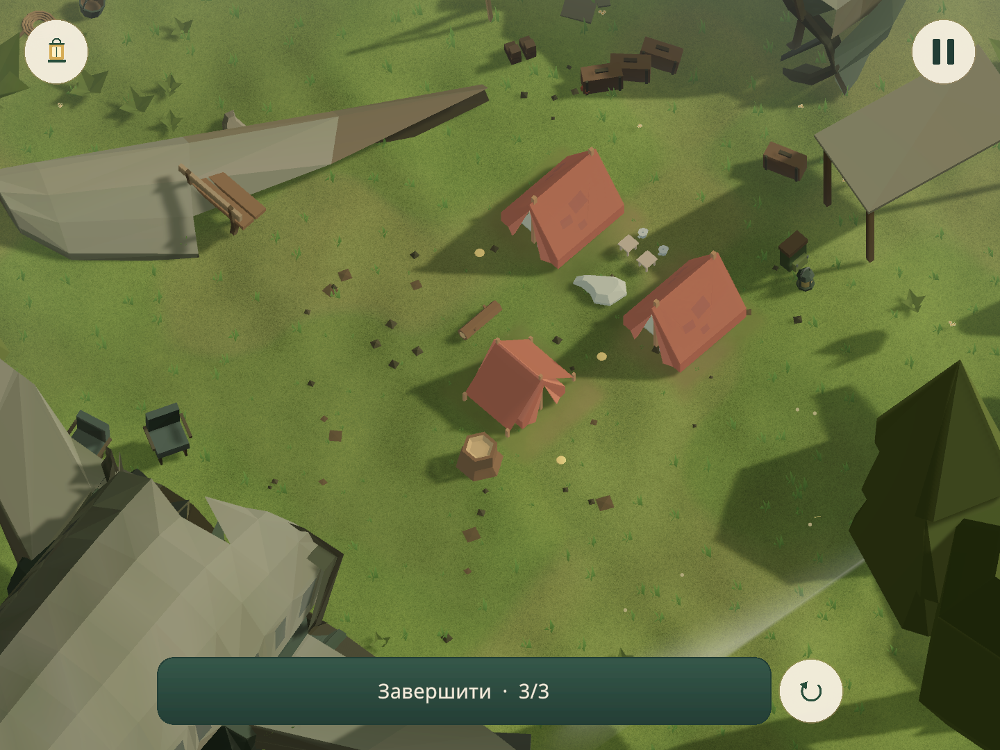

# Трава без пласких смужок — 24.10.2026

Пласкі текстурні картки видалено разом із card shader і card texture.
Залишені компактні об’ємні пучки з окремих геометричних травинок та спільна
деталізація ґрунту. Поточна важка сцена №44 пройшла повний native бюджет
**49 634 / 50 000**; її головне меню — **47 086**.

Це результат вибраної native сцени, а не native сертифікація всіх 100 рівнів.
Повне художнє приймання №44 залишається відхиленим через попередні
`landmark.clipped` і `support.floating`. Усунення трав’яних смужок і бюджет
перевірені окремо; ці старі дефекти не приховані й кампанія не перепублікована.

[Портретний кадр](images/grass-after-portrait.png) ·
[Меню](images/grass-menu-portrait.png) ·
[Порожнє поле](images/grass-empty-landscape.png)

## Що змінилося

- `CampMeadowTufts` створює до 785 пучків, по чотири окремі вузькі листки.
  Верхня межа — 3 200 трикутників; у перевіреній сцені — 3 140.
  Немає перехрещених ribbon quads, alpha clipping або нового шару площин.
  Розмір, нахил і поворот різняться; вітер і приминання використовують чинний shader.
- Покрив охоплює фактичні межі всіх ground meshes, включно із зовнішніми
  смугами старих heightfield. Корені спираються на показану поверхню;
  вода, отвори шахт і непридатні схили відсікаються. На полі трава нижча.
  Узимку листків немає; сезонний сніг збережено.
- Одна спільна mipmapped текстура 256×256 дає деталь і колір землі без
  додаткової геометрії. Карткова текстура більше не створюється.
- У budgeted worlds тканина має один прохід подрібнення замість двох.
  Первинні вершини, жорсткі деталі, колізії й маска вітру збережені;
  кеш розрізняє деталізацію. Меню отримує бюджет від власного
  `CampGroundDetails` ще до створення `CampArtView`.
- Чотири перевірені параметричні смуги зовнішньої землі скорочено
  4 096 → 256 трикутників зі збереженням внутрішньої та зовнішньої меж.
  Змінена/cut topology не спрощується. Фізичні висоти не переписані.

## Актуальна native перевірка

WorldOps `20261024T160418586-df0c41`, №44 / `gen:qc_camp:60`, поточні джерела.
20 перевірених кадрів: portrait 750×1334 і landscape 1440×1080; порожнє поле,
справжнє розміщення, встановлені намети, інша фаза вітру, завершення, меню
та чотири дальні діагностичні ділянки в кожному профілі. Coverage diagnostics
не підміняють звичайні gameplay кадри з UI. Обидва проходження завершені;
збереження — тільки в пам’яті. Новий Editor і player build не запускалися.

| Максимум | Mesh instances | UI | Максимальна місткість particles | Разом |
|---|---:|---:|---:|---:|
| Gameplay, обидва профілі | 42 950 | 3 786 | 2 898 | **49 634** |
| Меню, portrait | 41 030 | 3 406 | 2 650 | **47 086** |

Усі 12 native census пройшли 50 000; непорахованих renderer-ів немає.
Враховані також неактивні меші та екземпляри за камерою. Повторні color,
shadow і depth passes не множать геометрію сцени. Це не замір mobile FPS.

[Підрахунки, SHA-256 кадрів і маніфест](native-evidence.json) ·
[Авторський hash-bound verdict](final-verdict.json).
PNG скопійовані побітово з оригінального пакета; оригінали й повні квитанції
збережені в `QuietCamp/UserSettings/WorldOps/<run-id>/`.

## Перевірки коду й даних

- **12/12 native EditMode**, 11,20 с: трава без карток, спільні матеріали,
  захист джерел, audit policy, cache/rigid geometry обох наметів, межі
  terrain margins, відхилення cut mesh та порядок створення меню.
  [Оригінальний результат](native-tests/menu-owner-tests.json).
- **100/100 portable checks** для всіх активних рівнів: незмінність джерел,
  захист об’єктів, детермінованість, topology та відомі категорії геометрії.
  Максимум відомого підсумку — 37 260; він не включає всі runtime компоненти.
  [Результат](final-portable/mobile-budget-audit.json),
  [хеші перевірених джерел](final-portable/budget-source-manifest.json).
- `QC_Renderer.asset` не змінений; його дата запису — 12.10.2026, Git diff порожній.
  Пазли, історичні ревізії, кампанія, прогрес і вихідні gameplay моделі збережені.

Рецепти: `grass-density-review.json` для п’яти сцен,
`grass-budget-heavy-review.json` для №44. `runtimePresentation: true`
створює копію через ту саму політику, що й звичайне завантаження гри.
Дозволено тільки audit, previewOnly і повний scene gate 50 000; публікація
з цього режиму заборонена. Сервіс залишається єдиним власником підготовки й кадрів.

## Збережені невдалі етапи

- Картковий варіант відхилено користувачем; прогін
  `20261024T152919389-260b8f` скасований під час QC007. Він не є прийнятим.
- Перша геометрична заміна, `20261024T154008336-769e5f`: peak №44 — 60 578.
  [Відхилений verdict](heavy-rejected-verdict.json).
- Пілот п’яти сцен `20261024T155150161-cec2d3`, до останньої правки меню:
  QC001 — 41 510, QC007 — 42 263, QC009 — 43 752, №44 — 51 310,
  №71 — 33 783. [Усі підрахунки](pilot-native-evidence.json),
  [вердикти](pilot-verdicts). 100 кадрів переглянуті; цей старіший пакет
  не підміняє актуальний фінальний прогін. Збережені помилки опор,
  кадрування та рослин у воді залишаються явними.
- Ранній широкий WorldOps suite на попередній ревізії: 40 passed, 2 failed
  (`FieldCoverHasAHeightLimitAndBlendsPastTheOldRectangularApron`,
  `FieldCoverStyleSurvivesCaptureAndOnlyRefreshesTheBoard`). Це не успішний suite;
  фінальні 12 перевірок — окремий фокусний набір.
